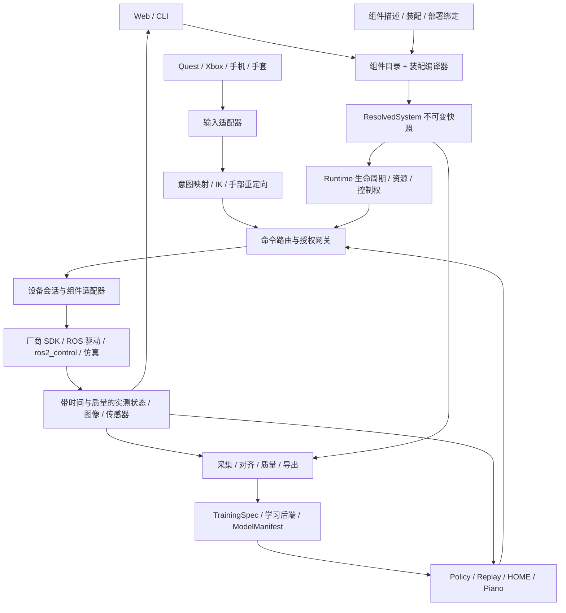

# MORLA 可组合机器人系统重构执行规格

版本：1.0。日期：2026-10-27（Asia/Shanghai）。状态：**原始设计规格**。当前软件与验收状态见 [统一路径实现记录](architecture_refactor/UNIFIED_IMPLEMENTATION.md)，本文保留原规划，不等于全部部署门禁已满足。

源码基线：`9449e59`，分支 `main`。本计划编写开始时工作区干净；具体文件哈希、源码定位和本轮检查见 [基线证据](architecture_refactor/baseline.json)。本文中的新包、新 API、新命令、配置字段均为目标设计，不能当作已经可用的功能。

配套文档：

- [按依赖排序的实施任务与 agent 交接](architecture_refactor/EXECUTION.md)
- [验收、测试矩阵与对抗性审查](architecture_refactor/VALIDATION.md)
- 原有 [迁移计划](MIGRATION_PLAN.md)、[迁移进度](migration_progress.md)、[坐标与运动学计划](coordinate_kinematics_optimization_plan.md)继续作为旧系统行为和历史证据；本计划不覆盖其真实硬件未验收项。

## 1. 要交付的系统

用户应能在 Web 中分别选择输入设备、机械臂、末端执行器、相机和其他传感器，连接控制关系与安装关系，保存一个版本化装配，预览数据键名和维度，再用同一装配进行遥操、数采、处理、训练配置生成、推理和回放。

例如：左 Nero + 右 Astral；左 XHand + 右夹爪；Quest 控制左臂、Xbox 控制右臂、手机控制某个末端；三路任意语义名的相机。这应是组件实例和绑定关系的变化，不再需要新增一个整机 launch、修改 Web 的品牌判断或重写数采切片。

**实施策略：以现有框架为基础渐进替换。保留驱动、IK、采集、推理中的成熟实现，新增“组件契约 → 装配编译器 → 统一运行时 → 各类适配器”这一条主线。** 配置只组合已存在的能力，不能替代机械适配、驱动实现、标定或模型训练。

### 1.1 必须完成的范围

1. 上游输入与机器人彻底解耦：连续运动输入和离散操作命令分别建模；Quest、手套、Xbox、手机使用同一输入接入规范。
2. 下游统一接入：机械臂、夹爪、灵巧手、相机、触觉等按能力实现接口。接入标准能力的新型号，只增加组件包、描述、适配器及其测试。
3. 装配独立于品牌与左右侧：实例 ID 是身份，`left/right` 是可选语义角色；支持零臂、单臂、多臂、仅传感器、只读监控配置。
4. 调度统一：生命周期、资源占用、命令所有权、执行时效、错误恢复、活动任务管理均由公共运行时协调。
5. 数据闭环：同一编译产物确定关节名、观测键、动作键、维度、相机角色、单位、时钟、坐标、质量和模型契约。
6. Web 配置器：新增组合无需编辑源码；Web/CLI/CI 使用同一个解析器、同一份诊断，不在前端维护第二套规则。
7. 兼容迁移：12 个现有 Profile 有逐一证据，旧数据可读；所有已知保护与现场修复进入回归。

### 1.2 分清四种“支持”

- `compile_valid`：配置结构、连接、资源与契约可解析。
- `backend_available`：所选 fake、物理仿真或 real 后端确实安装并实现。
- `deployment_verified`：具体设备、固件、接线、安装、工具与停止行为已有现场证据。
- `model_compatible`：具体 checkpoint 的特征、动作语义、视觉输入、归一化与运动学匹配。

Web 分开展示四项，不能把“YAML 校验成功”显示为“可安全运行”，也不能把“可以采集 54 维”显示为“任意模型都可推理”。

### 1.3 本期边界

第一版保持单个控制主机、单个活动装配会话、单操作者。装配内允许多个不同品牌机械臂与输入设备，并预留完整 namespace；跨主机分布式执行、多人控制同一资源、运行中热换硬件不是首发依赖。新后端和新组合先通过 fake/仿真，再按部署逐项开放 real。

首发必须提供 Xbox 连续遥操和手机触屏虚拟摇杆/按键的可用端到端参考实现。手机 AR 六自由度输入作为能力扩展，只有完成原生客户端、坐标与重定位验收后才能宣称支持；不能以“有一个 WebSocket 协议”代替手机可用性验收。

## 2. 当前源码事实与重构落点

本节是本轮阅读得到的事实，不是对 README 的转述。定位以函数/类名为主，行号和哈希见基线 JSON。

### F01：已有的抽象应保留

`src/common/morla_core/morla_core/profile.py::ProfileRegistry/validate_profile` 已统一加载与校验；`schema.py::FrozenSchema` 已有流、具名 state/action block、hash 和版本；`joint_mapping.py` 已有具名映射；`coordinate_contract.py` 已有坐标与工具链；`ownership.py`、`ros_ownership.py` 和推理节点已具备租约、ACK、HITL 逻辑。不要重新从零创建第二套这些能力。

### F02：Profile 是登记表，还不是装配器

`morla_bringup/config/robots.yaml` 登记 12 个 Profile。`robot_profile_launch.py::select_robot_stack` 按 `robot_id` 判断 Nero/Astral：Nero 仅允许 `nero_arm/xhand`；Astral 仅允许 `arm/gripper/wuji_hand`，real launch 还限制单个右侧 Wuji。`launch/robot.launch.py`、`nero_xhand_stack.launch.py` 继续包含品牌和专用参数分支。混合 Nero/Astral 不能靠新增 Profile 完成。

### F03：左右侧与品牌渗透到坐标、控制与状态

`profile.py` 只接受 `left/right/base`，有 `_arm/_ee` 后缀关联规则；`coordinate_contract.py::build_coordinate_contract` 根据品牌选择缺省模型、只识别两类 arm、以 side 作字典键，并要求至少一条臂。`control_coordinator_node.py` 大量按 Nero/Astral 分派服务和就绪条件。改 launch 而不改这些逻辑仍无法支持第三条臂或纯相机系统。

### F04：上游仍是 Quest 中心

`morla_input/quest3_udp_mocap.py` 发布 `quest3/*`、`hand_landmarks/*`，已有很有价值的 session/sequence/时钟同步/换系保护。`morla_bringup` 的 start/workpos gate 与机器人 teleop 还消费 Quest Joy 等接口。`morla_operator_control/commands.py` 已抽出语音、脚踏等离散操作语义，但没有完成通用连续运动输入抽象。应复用其去重和 ACK，不能要求 Xbox 伪装成 Quest 骨架。

### F05：逻辑组件不等于一个物理驱动

`astral_robot_control/driver_node.py` 用一个 SDK/控制板连接驱动双臂、头腰、夹爪，反馈有 18 维整机布局；`joint_layout.py` 保存物理分段。只选右 Astral 也可能占用整块控制板和绑定端口。`astral_robot.yaml` 当前 `auto_ready: true`，接入新生命周期时必须拆开连接与使能，不能在“检查设备”阶段触发运动许可。

Nero 已有 `driver_core.py`、`sdk_adapter.py`、fake/hardware 分离及大量 enable/home/workpos/反馈测试，应作为适配样板。XHand 有 `xhand_adapter/core.py/adapter_node.py`，Wuji 使用现有厂商 ROS 驱动，保留底层实现。

### F06：当前数据通用性有明确缺口

`FrozenSchema` 虽然分别定义 state/action 维度，`FrozenPipelineSchema` 主要围绕 state block；`pipeline/align_data.py` 分配 action 使用 `state_dim`，`next_state` 使用整条 state；`convert_to_lerobot.py` 的 action 元数据也使用 `state_dim/state_names`。因此 **state_dim ≠ action_dim 必须作为第一类回归用例**。这在加入速度、触觉、只读关节、输入观测或部分控制时会直接暴露。

`FrozenSchema.validate()` 要求至少一台相机。`profile.py` 的 sensor decoder 只允许 XHand 原生消息，采集节点 `_mk_sensor_cb` 内部理解 XHand hand_id/手指结构。扩展传感器不应再修改采集核心。

### F07：旧 hash 并非纯模型语义身份

`FrozenSchema.layout_dict()` 包含 profile_id、robot_id、topic 等，`kinematics_hash` 当前混入输入 basis/alignment。namespace 改名或换输入设备可能改变旧 hash。不能直接重定义同名 hash 让旧模型“突然匹配”，必须版本化拆分。

### F08：推理已有布局检查，但仍直接发布驱动目标

`morla_policy_inference/robot_io.py::ObsLayout` 已支持 FrozenSchema 和具名重排；`backend.py` 检查布局、容量和运动学；`node.py` 按目标类型直接创建 JointState/Float64 publisher。应保留引擎、chunk 调度与已有防抖措施，将最后输出改为公共命令入口，不能再与 teleop 共同争写驱动 topic。

### F09：Web 管理固定 Profile 与多个进程通道

`web_server.py` 加载 Profile，`/api/v1/profiles` 仍识别 arm/nero_arm，`/profile/launch` 转为固定 launch；`launch_manager.py::Preset.command/start` 拼接命令后交给 `bash -c`。这是现有受限预设机制；开放用户配置后必须改为受限 LaunchPlan 和 argv，不能直接扩展为任意可执行 YAML。`monitor_node.py` 的硬编码订阅、前端状态类型和图表也需由组件目录驱动。

### F10：训练入口仍有部署与品牌绑定

`scripts/openpi_train.sh` 固定 `pi05_astral*`、机器目录和数据集链接；`act_train.sh` 有可覆盖的训练程序路径，但尚无统一训练契约产物。训练重构须落实到生成配置、数据兼容检查、checkpoint 元数据和真实加载测试，不能只“导出 LeRobot 格式”就宣布训练贯通。

### F11：旁路业务也拥有控制权

`morla_web_manager` 的 piano 模块及独立 MORLA-piano 集成已有独占、恢复、维护与设备直连路径。该路径必须纳入同一物理资源锁、命令权与停止策略；外部工程不可访问时保留隔离的 legacy lane，不宣称已经统一。不得顺便重写钢琴算法或覆盖现场标定。

### F12：现有测试资产丰富，但环境分层明确

已有 `scripts/test_offline.sh`、`test_ros.sh`、`test_policy.sh`、两套 sim integration，以及各包的行为测试。当前 Mac 默认 Python 3.9.6 不具备 pytest/PyYAML/numpy/rclpy；应用附带 Python 3.12 有 numpy，但无 pytest/PyYAML/rclpy/h5py。本文未把旧文档中的 PASS 当成本轮执行结果。完整 ROS/真机测试须在目标 Linux 环境进行。

## 3. 架构决策：统一边界，复用成熟基础设施

### D01：保留 ROS 2 Humble，先不全量切换底层控制框架

ROS 2 继续承担本机消息、服务、action、TF 与节点管理。MORLA 的新运行时负责装配、会话、权限和可观测性；厂商 SDK 或 ros2_control 负责设备执行。不会写一个 Python 中央循环去模拟所有驱动的硬实时控制。

ros2_control 可管理控制器生命周期和硬件接口，适合作为一种执行后端；并不自动解决输入映射、组合数据 Schema、模型适配和 Web 配置。先提供可选 `ros2_control` backend 和一个 mock 原型，验证与 MORLA 契约的衔接；现有 SDK 驱动保留包装接入。Humble 的不同硬件频率支持需按所装版本验证，不假设 Rolling 文档中的能力可直接使用。[官方 Controller Manager](https://control.ros.org/humble/doc/ros2_control/controller_manager/doc/userdoc.html)、[Humble 多更新频率说明](https://control.ros.org/humble/doc/ros2_control/hardware_interface/doc/different_update_rates_userdoc.html)。

如果后续有硬实时需求，基于实测决定迁移哪些适配器为 C++/ros2_control，而不是先重写全部 Python SDK。软件调度 deadline 不等于硬实时保证。

### D02：LeRobot/OpenPI 是数据与学习后端

LeRobot 已有 Robot、Teleoperator、Camera 扩展机制，可以提供 MORLA bridge 复用训练与推理生态；不把整个控制现场迁成 LeRobot 单脚本，也不再维护另一个厂商接入体系。桥接层调用 MORLA 会话与契约，不绕过资源锁直连设备。[LeRobot 官方硬件接入说明](https://huggingface.co/docs/lerobot/main/integrate_hardware)。

OpenPI 和 LeRobot 均锁定经过测试的版本/commit，外部代码路径作为显式环境配置。模型支持能力以所锁版本及所选 checkpoint 为准。[OpenPI 官方仓库](https://github.com/Physical-Intelligence/openpi)。

### D03：三个配置层，一个编译结果

1. **ComponentDescriptor**：组件包声明“我是什么、有什么端口/能力/限制、怎么装载”。只由安装包提供。
2. **AssemblySpec**：用户声明“选哪些实例、如何安装、输入如何绑定、想采什么”。可由 Web 编辑。
3. **DeploymentBinding**：现场声明“实例对应哪个序列号/控制板/总线/设备、哪套标定、哪个后端”。包含本机路径与 secret 引用，分离于可分享装配。

三者经纯逻辑编译，输出不可变 **ResolvedSystem**。运行、采集、处理、训练、推理均使用其快照或由其派生的契约；节点不能各自重新读一份可变 YAML 决定有效参数。

### D04：分开物理设备会话和逻辑组件

DeviceSession 是 SDK 连接、控制板、串口或相机采集句柄的唯一持有者；ComponentInstance 是对外暴露的臂、手、夹爪或传感器。一个 Astral 会话可以导出多条逻辑端口；一条共享总线也可以包含多个手地址。资源锁按真正排他资源和可共享地址组声明，不能简单把“同一 CAN 网卡”一律视为冲突，也不能把两个逻辑组件默认当作两个独立设备。

### D05：统一输入语义，但不强行统一输入维度

输入输出能力类型包括 `pose6d`、`twist6d`、`joint_targets`、`hand_landmarks`、`scalar`、`axes_buttons`、`operator_event`。明确的控制映射插件把某种输入转成组件目标；没有映射就拒绝绑定。Xbox 没有 21 点骨架，手机 IMU 没有可靠位置；不得填零伪造能力。

### D06：所有动作来源经过统一命令授权路径

遥操、策略、回放、HOME、维护动作、钢琴桥接都是 command producer。每个控制资源在一个 epoch 内只有一个有效 writer。公共 runtime 管理租约；最终设备网关验证 token/epoch/序号/期限/关节集和停止条件。底层限位和看门狗继续存在。

## 4. 目标数据流与包边界



### 4.1 包职责与依赖方向

- **morla_core（扩展）**：ROS-free 契约、组件目录、编译器、特征布局、坐标图、hash、兼容迁移和验证逻辑。新增 `composition/`、`contracts/`、`plugins/`，旧 `profile.py/schema.py` 保留兼容入口。不 import rclpy、torch 或供应商 SDK。
- **morla_interfaces（新）**：ROS IDL，承载会话/命令/状态/输入/操作结果信封；标准图像、CameraInfo、JointState、Pose 等继续复用标准消息，避免将一切变成无类型 JSON。
- **morla_runtime（新）**：设备会话生命周期、独占资源、执行图、命令路由、故障与事务日志、组件状态聚合。纯状态机与 ROS/进程适配分开；独立于 Web。
- **morla_teleop（新）**：通用输入绑定、模式/目标选择、deadman、相对锚定、限速、IK 与 retarget 插件调度。品牌算法保留原包，由注册插件引用。
- **morla_input（扩展）**：输入设备适配器及输入协议；Quest 迁移在内，新增 gamepad/mobile；`wuji_glove` 保留协议实现。
- **现有机器人包（适配）**：设备 manifest、driver wrapper、能力实现、命名/单位映射、设备级停止、IK 插件。初期可放在现有 `morla_nero_robot/morla_astral_robot/morla_xhand_hand/morla_wuji_hand` 与各 control 包，不为每个实例再建 ROS 包。
- **quest3_video_streamer（复用）**：相机 source/采集 tap/时间戳/设备指纹继续复用；为相机能力注册适配器，WebRTC 预览是消费者。先解除功能耦合，包名改名不是关键路径。
- **morla_bringup（收薄）**：只将已验证 LaunchPlan 渲染为 ROS launch；旧 launch 成为显式 legacy 入口，不再增加组合分支。
- **morla_data_collect（改造）**：消费通用 stream codec 和数据契约；维持原始数据、对齐、清洗、sidecar、ACT/LeRobot 导出。
- **morla_learning（新，纯 Python）**：TrainingSpec、ModelManifest、backend config 生成、特征投影与握手；不内置训练算法。训练进程在自己的 Python 环境运行。
- **morla_policy_inference（改造）**：保留 engine/backend/client/chunk/replay，统一 ObservationAssembler/ActionMapper，并改用 runtime writer。
- **morla_web_manager（改造）**：装配编辑与运行监控，调用 compiler/runtime/learning 的稳定 API；不持有设备 SDK。

四个新包是协议、运行时、通用遥操和学习配置边界；不再为每个概念创建服务/消息总线。大型旧文件按本期职责拆分，不做与目标无关的全面格式化。

## 5. 组件契约与接入 SDK

### 5.1 Descriptor 的必需字段

R1 将以下内容固化为 JSON Schema 和 Python typed model，拒绝未知字段、重复键、非有限数值和未解析引用：

- `descriptor_version`、`plugin_id`、精确 `plugin_version`、`api_version`、安装包来源/hash。
- `kind`：input、actuator、sensor、controller、device_session；一种物理产品可导出多个种类端口。
- `ports`：方向、语义类型、消息 codec、字段名/shape/dtype/unit/frame/时钟/有效性、更新范围、QoS、是否必需。
- `command_modes`：position/velocity/effort/pose/trajectory/gripper_ratio 等实际实现的模式；不声明就不支持。
- `joints/features`：局部稳定名、类型（转动/移动/连续等）、单位、限位、速度/加速度约束、实测或回显来源。不能从 JointState 消息类型推断全是 rad。
- `backend_variants`：fake、物理 sim、real 各自入口、依赖、平台/ABI 和验证级别。fake 不冒充物理仿真。
- `resources`：会话共享 key、设备独占/共享规则、地址空间、端口、线程与停止能力。
- `operations`：prepare、enable、disable、home、reset、stop 等支持情况、作用范围、是否会运动、前提、超时/取消/结果语义。
- `geometry`：描述资源、命名空间规则、安装连接点、工具链、碰撞几何可用性、标定需求；传感器允许没有运动关节。
- `configuration_schema`、默认值、只读字段、需要停止后才能修改的字段和 UI 提示。UI 提示不是校验逻辑。
- `validation_artifacts`：版本绑定的离线/仿真/现场验证记录，不能仅有一个 `real: true` 布尔值。

### 5.2 发现与加载

ROS 部署通过 ament resource index 注册静态 manifest；纯 Python 使用受控的 entry points 注册同一描述。目录列表阶段只读描述，不导入 SDK、不打开串口、不使能电机。插件 ID+版本歧义时报错，不按安装顺序选一个。只有用户所选、受信安装包的入口才可加载；AssemblySpec 不能填写 Python import 路径或 shell 命令。

配置依赖必须锁版本；输出 lockfile 包含 plugin、codec、controller、model asset 与 compiler 版本/hash。组件安装可独立完成，不能由浏览器上传任意 Python 插件即执行。

### 5.3 统一接口的建议签名

以下是协议草案，R1 必须将类型、线程约束、错误枚举与返回值写成可测试规范；不是要求所有硬件实现同一大类。

```python
class ManagedAdapter(Protocol):
    def describe(self) -> ComponentDescriptor: ...
    def configure(self, context: AdapterContext) -> ConfigureResult: ...
    def health(self) -> HealthSnapshot: ...
    def close(self) -> CloseResult: ...

class StateProvider(Protocol):
    def read(self, now_ns: int) -> SampleBatch: ...

class ActuatorAdapter(StateProvider, Protocol):
    def activate(self, permit: ActivationPermit) -> OperationHandle: ...
    def submit(self, command: AuthorizedCommand) -> CommandReceipt: ...
    def stop(self, request: StopRequest) -> OperationHandle: ...
    def deactivate(self) -> OperationHandle: ...

class InputAdapter(StateProvider, Protocol):
    def feedback(self, event: OperatorFeedback) -> FeedbackReceipt: ...

class OperationProvider(Protocol):
    def invoke(self, request: OperationRequest) -> OperationHandle: ...
    def cancel(self, operation_id: str) -> CancelReceipt: ...
```

传感器实现 ManagedAdapter + StateProvider，不实现无意义的 write/home；输入也不实现关节驱动。可选 feedback/operation 使用 capability 检查，Unsupported 是显式错误。实时 SDK read/write 在专属 worker 中执行，公共 `read()` 读缓存快照，`submit()` 入有界邮箱；需同步调用的后端必须证明 deadline 内返回。超时后后台线程可能仍在执行，不能把 Future timeout 当作 SDK 已取消。

ROS/C++ 厂商节点可通过 BridgeAdapter 实现同一行为协议，无须改写为 Python 类。新集成者只需实现其能力所需方法、提供描述/几何/映射和符合性测试；若引入现有端口体系未覆盖的新物理能力，需显式扩展契约版本，不能承诺永远只填几个函数。

### 5.4 统一数据和命令信封

`SampleEnvelope` 至少包含 `session_id/instance_id/port_id/source_epoch/sequence`、源端时间、主机接收单调时间、统一记录时间、`clock_domain/sync_uncertainty`、`frame_id`、字段有效掩码、来源（measured/estimated/command_echo/synthetic）及错误原因。

`CommandEnvelope` 至少包含 `session_id/assembly_revision/target_resource/producer_id/lease_token/epoch/sequence`、命令模式、具名目标及单位、主机可比较的 deadline、可选 group sequence 和执行时间。跨设备时间必须先转换到已同步的会话时域；真实看门狗使用主机单调时钟，不依赖 NTP wall clock 或仿真 `/clock`。

`CommandReceipt` 分清 rejected、accepted、dispatched、device_acknowledged、completed；设备不提供 ACK 就标记 unknown，不把成功 publish 当作执行完成。记录 requested、经限制后的 authorized target、实际 dispatched target、实测反馈，训练动作来源需显式选择。

高带宽 Image/PointCloud 不塞入通用 JSON 信封；标准 payload 配可关联的 metadata（序列、frame、源时刻），协议必须测试乱序关联。小命令采用强类型 IDL，标准 `FollowJointTrajectory` 等长动作可由后端桥接。

## 6. 装配规格与编译器

### 6.1 配置示例：混合品牌与多输入

下列 YAML 是目标规格示例，尚不可运行。它刻意保留现场标定引用，不填造假变换。真实组件名与端口名在 R1/R4 固化；缺少标定时可生成诊断但不能取得 real 激活许可。

```yaml
assembly_version: 1
assembly_id: mixed_workcell
revision: 1
instances:
  arm_a: {plugin: morla.nero.arm, version: "1.0.0", role: left_arm}
  arm_b: {plugin: morla.astral.arm, version: "1.0.0", role: right_arm}
  hand_a: {plugin: morla.xhand.hand, version: "1.0.0", role: left_tool}
  grip_b: {plugin: morla.astral.gripper, version: "1.0.0", role: right_tool}
  front_cam: {plugin: morla.camera.ros_image, version: "1.0.0", role: overhead}
  wrist_cam: {plugin: morla.camera.uvc, version: "1.0.0", role: wrist_left}
  vr: {plugin: morla.input.quest, version: "1.0.0"}
  pad: {plugin: morla.input.gamepad, version: "1.0.0"}
  phone: {plugin: morla.input.mobile, version: "1.0.0"}
mounts:
  - {child: arm_a.base, parent: workcell, calibration: mount_nero_v1}
  - {child: arm_b.base, parent: workcell, calibration: mount_astral_v1}
  - {child: hand_a.mount, parent: arm_a.flange, calibration: nero_xhand_adapter_v1}
  - {child: grip_b.mount, parent: arm_b.flange, calibration: astral_gripper_v1}
  - {child: front_cam.optical, parent: workcell, calibration: overhead_cam_v1}
  - {child: wrist_cam.optical, parent: arm_a.flange, calibration: wrist_camera_v1}
control_groups:
  manipulation: {members: [arm_a, arm_b, hand_a, grip_b], fault_policy: stop_group}
bindings:
  - id: vr_to_arm
    source: vr.left_pose
    target: arm_a.joint_target
    controller: morla.cartesian_delta_ik
    parameters: {kinematics: arm_a, alignment: vr_to_workcell_v1}
    deadman: vr.left_grip
  - id: pad_to_arm
    source: pad.axes
    target: arm_b.joint_target
    controller: morla.gamepad_cartesian_jog
    parameters: {kinematics: arm_b, axes_map: xbox_default_v1}
    deadman: pad.right_shoulder
  - id: vr_to_hand
    source: vr.left_landmarks
    target: hand_a.joint_target
    controller: morla.xhand.retarget
    deadman: vr.left_grip
  - id: phone_to_gripper
    source: phone.scalar
    target: grip_b.closure
    controller: morla.scalar_map
    deadman: phone.hold_to_control
capture:
  state: [arm_a.position, arm_b.position, hand_a.position, grip_b.position]
  action: [arm_a.position_target, arm_b.position_target, hand_a.position_target, grip_b.closure]
  images: {scene_top: front_cam.rgb, left_wrist: wrist_cam.rgb}
  auxiliary: [vr.left_pose, pad.axes, phone.scalar]
  action_source: dispatched_command
  dataset_fps: 30
```

另存 DeploymentBinding，将 `arm_b/grip_b` 绑定到同一 `astral_board_01` 的不同逻辑端口，将 arm_a 绑定到 CAN 会话，hand_a 绑定到串口会话，相机绑定到序列号/指纹；控制板上未选中的关节也须有明确的静止/禁用方案和影响范围。换成双臂双手、双臂双夹爪时修改实例及绑定即可；没有合适的机械连接件或驱动通道时必须报不支持，不能“软件选上就算安装完成”。

### 6.2 编译步骤

1. 严格解析配置、版本迁移和引用；限制 YAML 深度/大小/alias，支持现有合法锚点但拒绝重复键和执行标签。
2. 从受控目录解析描述与锁定依赖；未知插件、缺资源、ABI 不符分别报错。
3. 构建实例/端口图、安装树、控制绑定图、设备会话图与启动依赖图。数据流可包含反馈回路；启动依赖必须是 DAG，不能简单禁止全部控制闭环。
4. 检查端口语义、shape/单位/命名、可用 controller、模式、控制所有权、frame 可达性、机械连接与配置的后端能力。
5. 合并共享设备会话；检查设备地址、CAN/串口/IP/相机指纹/UDP 本地端口冲突；具体设备缺失属于 preflight，不伪装为 schema 错误。
6. 合成 robot_description、TF 命名、碰撞资源与运动学契约；输出安装/工具标定需求。
7. 编译 ObservationSpec、ActionSpec、CaptureSpec、TrainingProjection；分别生成有序 feature list、索引和 codec。
8. 生成 LaunchPlan、LifecyclePlan、ControlPlan、ResourcePlan、SafetyPolicy、ResolvedSystem 与 lockfile，并输出可读 diff/diagnostics。

纯 `validate/compile/preview` 不打开设备。`preflight` 是单独动作：默认只读探测；任何会打开抱闸/使能的 SDK 探测必须显式标为有副作用并通过运行操作授权，不能藏在“扫描”里。

同输入+同依赖版本必须得到字节级稳定产物，除了单独的生成时间/运行 ID。硬件地址和 secret 不进入模型特征 hash；公开导出必须脱敏 secret 和敏感主机路径。

### 6.3 输出与版本

每个装配版本保存 `assembly.yaml`、`deployment_binding` 引用、`component_lock.json`、`resolved_system.json`、`launch_plan.json`、`capture_schema.json`、`feature_contract.json`、`geometry_contract.json`、`diagnostics.json`。写临时目录校验成功后原子替换 manifest 指针，不逐文件覆盖活动版本。

`assembly_hash` 识别完整语义装配；`deployment_hash` 识别设备绑定；`capture_schema_hash` 识别采集格式；`feature_contract_hash` 识别有序模型输入输出语义；`geometry_hash` 识别关节约定、安装、工具与相关标定；`input_mapping_hash` 识别输入映射。所有 hash 有算法/版本和规范化规则，有限浮点/Unicode/集合排序要固定。

旧 `schema_version=2` 的 layout_hash/schema_hash/kinematics_hash 原样保留。新语义使用 `schema_version=3`；旧 Profile 的兼容视图可保持 v2 hash，新 v3 派生身份另存，不能覆盖旧字段。

输入由 VR 换成 Xbox，只要机器人和记录的模型特征/动作语义相同，不必使机器人模型特征 hash 改变；输入映射 hash 和采集来源仍变化。若输入被选入模型观测，或映射改变了模型动作语义，模型契约必须变化。

## 7. 统一运行时与执行调度

### 7.1 两层生命周期

组件生命周期参照 ROS managed nodes：unconfigured → inactive → active → finalized/error；现有非 LifecycleNode 用 wrapper 实现，不要求一次重写厂商节点。[ROS 2 生命周期设计](https://design.ros2.org/articles/node_lifecycle.html)。

系统状态另行定义：DRAFT → VALIDATED → PREPARING → READY_DISARMED → ACTIVE → STOPPING → STOPPED，异常进入 FAULTED/ESTOP_LATCHED。`READY_DISARMED` 表示设备可观测且尚无运动许可；进程活着、topic 出现、SDK 返回成功都不足以进入 ACTIVE。

首次连接、配置加载、Web 刷新、输入重连均不自动 enable/home/resume。Nero 冷启动可能需要电机使能才能获得反馈，须保留为显式 `prepare` 操作及已验证反馈确认流程，不能套用“永远先读到反馈才允许使能”的循环前提。Astral `auto_ready` 在新路径固定关闭或从连接阶段移除。

### 7.2 运行调度负责什么

- 启动：申请主机级资源锁 → 启动设备会话 → 检查真实反馈与时效 → 启动适配/映射 → 注册 producers → 等待显式激活。
- 执行：每个设备/控制组按声明的周期独立调度；上游 latest-value 输入有界缓存，非实时操作用可靠队列/action；相机编码、磁盘写入、网络推理不得占用驱动执行线程。
- 停止：撤销命令权 → 按设备定义发停止/减速/保持操作 → 收集反馈 → 关闭依赖者 → 关闭会话 → 释放锁。软件 stop 不等同认证硬件急停。
- 异常：故障事件携带根因、受影响资源、是否可重试、最后命令及测量年龄；系统不自动重放未确认动作。

停止动作不能统一为“给所有关节发零”或“全部断力”。不同执行器需要保持载荷、制动或速度归零；`StopPolicy` 与独立设备看门狗按已验证模式声明。若 SDK 不可中断且没有可靠停止/板端超时能力，该部署不具备所需停止保证，应阻止 ACTIVE，而不是在公共线程上无限等它返回。

### 7.3 控制权与切换

租约资源是 actuator 的 command interface/control group；物理板级 enable/home/estop 的影响范围由 descriptor 声明，可以比逻辑组件大。第一版 policy/replay/HUMAN 接管按整个 manipulation group 完成，避免未验证的混合接管；手工映射可让多个不同输入绑定到不同资源。

切换事务：校验请求 → 冻结旧 producer → 清理 pending command/chunk → 等待各 gateway ACK 与 fresh state → 增加 epoch/fencing token → 为新输入重新锚定/回中 → 才发新许可。任何 ACK 缺失、输入过期或部分成员失败都保持禁止写入。相同 request_id 幂等返回同一操作，不重复 HOME/enable。

命令按 `session+resource+epoch` 检查严格递增 sequence，过期拒绝；重启生成新的会话/epoch，旧消息不可生效。TTL 到期仅撤销许可，不自动给手动遥操让路；旧 `PolicyLease.manual_allowed` 的“未见租约可手动”行为仅留在 legacy 路径。

### 7.4 多频率与同步语义

不设一个强制的“所有设备 100 Hz”。保留现有驱动频率，描述输入频率、执行周期、最大样本年龄、命令 TTL、队列策略、允许的执行偏差。插值/限速必须是显式 controller，不能由驱动收到稀疏目标后任意补点。

双臂 group 可共享 `group_sequence/desired_execute_at`。不支持定时下发的后端只保证有限偏差的尽力协调，测量实际 dispatch/state 时间差；需要同步屏障的任务若后端无法满足则拒绝。原子授予一组资源不等于两个真实电机原子执行；发送一半失败时执行定义好的 group stop，并完整记录部分执行。

默认不允许 real 与 fake actuator 混在一个活动运动 group；传感器回放或 HIL 要显式声明混合模式、来源标签和测试隔离，不能悄悄回退到 fake。

### 7.5 旁路防护与资源争用

旧 teleop/policy/driver 的直接 command topics 必须 remap 到会话私有入口，旧节点不能同时保留原公共写口；所有标准入口、CLI、piano 维护路径在开设备前申请同一主机锁。迁移阶段无法网关化的旧路径运行在独占 legacy lane，新 runtime 与其互斥。

租约防误用不等于恶意 ROS participant 隔离。若需要防非受信进程，另加 ROS 安全策略/主机权限；不要把 topic namespace 或 ROS_DOMAIN_ID 宣称为安全边界。验收至少测试一个被遗留启动的合法旧 writer 无法继续影响新会话。

## 8. 输入与通用遥操

### 8.1 输入来源和映射必须分离

InputAdapter 只负责设备采样、规范化数据、原始时间/有效性/重连 epoch 和反馈；Binding/Controller 才解释“这个按钮控制谁”。设备与机械臂不互相 import。

- Quest：保留 PacketGuard、严格包头、同步、重复/乱序拒绝、world/body latch；把其输出映射到命名 input ports。旧 Quest topics 只由兼容桥提供。
- Xbox：优先复用 ROS joy 的 `game_controller_node` 与 SDL 映射，在适配器声明逻辑轴/按钮；设备 ID、死区、回中、deadman、断连归零是配置与测试内容。[ROS joy 官方索引](https://index.ros.org/p/joy/)。
- 手机：提供配对后的触屏虚拟摇杆/按住控制/离散按钮客户端和有界 WebSocket 接入；校验 session/sequence、接收年龄、心跳、消息大小、认证绑定。后台切换、锁屏、掉网立即撤销活动许可。输入通道与管理 API 分离。
- 手套：保留已有采样，输出显式骨架/关节语义，MANO/模型专属变换在 retarget 插件。
- 语音/脚踏/键盘：沿用 operator commands，加入目标 scope 和会话身份；不能直接变成关节目标。

### 8.2 控制器插件

首发实现/适配：`cartesian_delta_ik`、`gamepad_cartesian_jog`、`joint_jog`、`scalar_map`、已有 XHand/Wuji retarget、离散 operator action mapping。输入端口和输出能力需静态匹配；不兼容错误给出缺少的转换器。

IK 接口至少接受目标 frame/TCP、完整具名 seed、限位、deadline，返回成功/不可达/限位/不连续/超时及具名解。保留 Nero/Astral 算法，拆出公共锚定与输入处理前先做数值黄金回归，不能改着接口顺便替换运动学解法。

Xbox/手机选择目标臂时，先松开 deadman → 清除积分/锚点 → 新目标确认 → 再按住启动。一个手柄控制多个末端可使用显式模式和手势 preset/synergy，必须标注降维动作策略；不能把一个标量复制成 12/20 维假“完整手型控制”。

deadman 与重锚由 binding scope 管理，不再写死左/右 grip。pose frame/设备 epoch 改变时停止对应 group，清滤波历史，要求重新启动；禁止用上一帧跨参考系做 delta。

## 9. 几何、安装、模型与仿真

组件实例统一 namespace，驱动关节名、规范关节名、URDF/MJCF 名分别有显式双向映射；角色 left/right 不参与索引猜测。安装树无环且每个 child 单父节点；每台相机 optical frame、每个 arm base/flange/tool/TCP 分开。

`GeometryContract` 与 `InputMappingContract` 拆开。静态安装、动态 TF、来源时间和校准状态可追踪。沿用现有 Nero J2 零位、左右镜像规则、link7 活动 tip 与未验收 flange/TCP 边界；不得因新架构引入“更好看的”默认 TCP。

混合品牌可能仍挂在同一 Astral 躯干或独立支架上，模型来自实际装配；不能默认两臂基座重合。碰撞几何缺失时不宣称碰撞安全；新混合 real 装配必须完成相互空间/工具/载荷限制验证。

仿真分层：fake 用于协议和状态机；单组件仿真验证具名映射；**同一物理场景**的组合 MuJoCo 后端验证双臂/手/工具/相机/碰撞。把两套整机 sim 进程并排启动不能算混合物理仿真完成。组合 builder 处理前缀、mesh 路径、actuator/sensor 索引、初始化和采样时间，保留已有 sim 的固定基线。无真实惯性/碰撞模型的组件只能声明运动学或协议仿真等级。

## 10. 采集、处理、训练、推理的统一语义

### 10.1 三份显式规格

- ObservationSpec：输入模型的具名数值、图像和可选传感器，含独立顺序/单位/shape/来源。
- ActionSpec：模型输出的具名控制特征、顺序、模式和目标组件，可能少于或多于 state 维度。
- CaptureSpec：所有需要落盘的 raw/auxiliary/event 流；不要求都进入模型。

特征 ID 建议由稳定 instance ID + port + local feature 组成；展示名/角色可修改但不覆盖 ID。相机同时区分硬件指纹、组件 ID、数据集键、模型槽位，不根据 USB 编号或数组位置推断。“改一个展示标题”不改模型契约，“改一个数据键”必须生成显式映射版本。

### 10.2 Schema v3 与旧数据

v3 允许 0 相机、0 actuator、可选 sensor、独立 action block 和来源掩码；视觉模型单独检查必需相机。sensor codec 在插件侧解析为标准 numeric/tensor/image 数据；XHand 原生保留可追溯 raw/sidecar，不再让 collector 认识 hand_id 协议细节。

旧 CollectSchema v1 与 FrozenSchema v2 的读写路径保持语义，v1→v2 现有升级器保留。新 `to_v3` 显式转换，输出来源版本/hash、迁移器版本和差异报告；读取旧数据不原地改文件。v2 兼容输出仅在新配置可无损表示时允许，否则拒绝。

解决 state/action 分离需同时修改 `FrozenPipelineSchema`、align、repair/validate/preview、LeRobot/ACT 导出、统计、replay 和推理映射；只改 schema.py 不算完成。构造观测 11 维/动作 8 维、含只读与速度状态的最小样本验证每个元素。

### 10.3 动作语义与数据对齐

每个 action feature 标明 `absolute_position/velocity/effort/closure_ratio/delta_pose` 等语义；`next_state` 是标签生成规则，不等于执行模式。新采集同时保留 requested/authorized/dispatched/feedback，CaptureSpec 明确选择训练标签来源。

`next_state` 仅能用于存在明确 state→action 对应关系的特征，按具名映射取下一有效时刻，不把整个 observation 复制成 action；末帧 hold 标记人工合成/掩码，不参与无说明的统计。时间对齐保存源索引、源时间、年龄、重复帧、有效性和插值策略。图像不会因关节插值而“变得同步”；保留现有按源帧选取的审计能力。

多设备时钟漂移/重连、相机掉帧、过期命令、磁盘满都有记录事件和 quality reason。数值缺失不能默认填零；非有限值拒绝或保持明确 invalid mask。实际反馈、目标回显、估计、fake 和仿真状态必须可区分。

episode 在开始时冻结完整契约与运行参数快照；采集中不允许换装配、feature order、相机键、TCP 或单位。若停止后修改，产生新 revision/session；崩溃恢复依赖 manifest/完成标记，不能把半写文件当可训练数据。

### 10.4 训练

TrainingSpec 包括数据集 fingerprint、feature/action 映射、相机槽位/分辨率/颜色/预处理、时间窗口/fps、动作模式、normalization 统计 fingerprint、backend/commit、容量和训练参数。

新增 `morla_learning` 的 ACT/LeRobot 与 OpenPI backend：从契约生成完整训练配置与 argv，替换固定 `pi05_astral*` 和硬编码目录。外部后端需要代码注册配置时，由版本锁定的 bridge package 提供，不用自动改第三方仓库源码字符串。

模型适配器声明支持的 state/action 最大维度、shape、相机数量、可选模态和动作模式；超出容量立即报错。允许明确声明、双向可验证的 feature projection/padding/mask，但禁止静默截断 38/54 维。相同维数的不同关节/语义也不兼容。

产出 `ModelManifest`：训练契约/hash、数据来源、特征顺序、norm hash、几何契约、相机变换、运行依赖和 checkpoint hash。只有实际训练或 checkpoint 加载验证后才能写通过；仅 dry-run 标记为 config_valid。GPU 缺失不阻止配置与 loader 测试，但不能将训练标为完成。

### 10.5 推理与回放

启动进行 runtime schema ↔ dataset/ModelManifest ↔ backend handshake，检查特征而非单纯长度；相机投影和 normalization 同样校验。默认要求相关几何一致；声明支持多 embodiment 的模型必须有版本化支持范围和映射，不能用任意 `ignore_hash` 跳过。

动作映射后进入同一 gateway；限速/裁剪会记录实际下发值。chunk 的预测时间、执行期限和 epoch 必须传播，接管/重连后清掉旧 chunk，策略慢或掉线走明确 starvation/stop policy。回放使用数据内冻结契约，不用当前磁盘上最新的装配 YAML。

## 11. Web 的可组合体验与 API

### 11.1 用户流程

组件库 → 创建/复制装配 → 选择设备实例 → 填安装/工具/相机关系 → 为输入端口绑定控制目标 → 预览数据键和 state/action 维度 → 查看兼容性与待满足条件 → 保存版本 → 选择部署 → preflight → 启动到 READY_DISARMED → 显式准备/激活 → 遥操/采集/策略。

首版使用可理解的表单和连接列表即可，不把自由拖拽画布作为编译器交付前提。用户应看见不兼容原因而非选项静默消失。界面明确当前选中版本、实际运行版本、正在录制的契约与设备反馈，不能只显示“最后选择的 Profile”。

### 11.2 建议 API（新建前缀 /api/v2）

- `GET /components`：静态目录、能力/配置表单 schema、安装状态。
- `POST /assemblies/validate`、`POST /assemblies/compile`：字段定位诊断、resolved preview、所需资源、数据布局；无硬件副作用。
- `POST /assemblies`、`GET /assemblies/{id}/revisions/{revision}`：创建不可变版本；带 expected revision 的更新防止并发覆盖。
- `POST /deployments/preflight`：对应装配/hash 的设备检查与可用性结果，不发运动命令。
- `POST /sessions`：从精确编译产物启动，返回 session/operation；同 idempotency key 不重复启动。
- `POST /sessions/{id}/operations`：prepare/activate/stop/reset 等，带 scope、前置 revision、request_id；GET operation 获取进度/结果。
- `GET /sessions/{id}/state` 与事件流：组件状态、阻塞原因、输入健康、资源、控制 owner、数据质量。
- `POST /training/validate`、`POST /training/configs`：按契约验证和导出训练配置；资源密集训练使用独立 job 管理。

v1 API 用兼容 facade 调 runtime，或明确处于 legacy 独占 lane；不能保留第二套可绕开 runtime 的启动和控制实现。移动输入是独立数据入口，不复用允许执行任意操作的管理 token。

### 11.3 配置操作边界

运行中允许编辑并保存下一版本，但不应用影响拓扑/数据/控制的修改；停止、finalize 当前 episode 并撤销许可后才能切换。UI 使用后端 schema 生成字段、错误路径和 capability gating；JSON 类型从同一契约生成 TypeScript，避免各处手抄维度枚举。

运行计划只有白名单 package/executable、类型化参数与 remap；process executor 使用 argv（不经过 shell）。预览与执行核对编译产物/hash，关闭“校验一个版本、启动另一个版本”的竞态。secret/path 的选择限制在已配置根目录，不能以重构为名提供文件系统任意读写接口。

## 12. 迁移原则与实施顺序

采用 R0–R10 阶段，详见 [EXECUTION.md](architecture_refactor/EXECUTION.md)。阶段产物用新的记录文件，与历史 P0–P11 区分。

1. R0 冻结现有 12 个 Profile、话题、有效参数、布局/几何、现场保护与数据样本；复现离线与 Linux 基线。
2. R1 固化 contracts/IDL/descriptor 与 schema v3；明确旧兼容策略和停止/租约语义。
3. R2 纯编译器 + legacy Profile importer + 确定性输出；先让“新配置能解释旧组合”。
4. R3 runtime 与 fake reference plugin；先完成单写者/资源锁/生命周期故障证明。
5. R4 现有设备适配器、会话拆分、几何与组合仿真；实现混合品牌纵向最小链路。
6. R5 通用遥操及 Quest/Xbox/手机/手套；保留输入与 IK 的黄金轨迹。
7. R6 schema v3 采集处理、state/action 分离、codec 与质量；数据元素端到端闭环。
8. R7 学习配置、ModelManifest、策略/回放统一 gateway 与 HITL。
9. R8 Web 装配器、动态监控、配置版本、事件流；通过用户场景 E2E。
10. R9 历史 Profile 新路径等价、部署级硬件验收、性能和长稳。
11. R10 停止扩展旧入口、发布迁移指南、删除已无消费者的兼容代码；盲接新组件考试。

优先做纵向切片：fake 新组件 → 编译 → runtime → 输入映射 → 录制一段 → 导出 → stub policy 回放；证明接口连通后再全量扩张适配器。UI、训练后端的完整实现以契约稳定为前提，不能各自先设计一套字段。

旧入口应明确 `legacy` 与 `composable` 模式，不做异常时自动回退；否则 real 失败可能误落 fake。每阶段独立 commit/PR，并保存旧可运行 tag/产物。回退只回退该阶段代码、配置指针和部署包，不覆盖 raw 数据、checkpoint、现场标定或 sibling 工程。

## 13. 完成判据

完成不是“增加一些接口类”或“Web 可以选多台设备”。以下同时满足才可宣布软件重构完成：

- 安装测试用的新 arm、sensor、input 插件后，不修改公共品牌分支，即可通过 Web 组成新系统并跑通数据/回放。
- 混合 Nero/Astral、双手、双夹爪、手爪混合、0 相机、3 条臂 fake、纯相机等矩阵有成功或明确拒绝的证据。
- 没有任何活动 producer 绕开同一控制权和资源检查；跨 brand 的停止、部分失败、断连、旧包重放不会产生未经授权的新命令。
- 12 个旧 Profile 的旧格式 hash/具名值保持可读与明确兼容；新模式有独立身份。
- state/action 不同维度、任意相机名字与只读传感器在 raw → aligned → export → loader → replay 中逐元素一致。
- Xbox 和手机实际端到端控制通过；有输入重连、目标切换和 deadman 负例。
- ACT/OpenPI 至少在锁版本环境分别通过数据加载和最小训练/加载验证；容量不支持的组合严格拒绝。
- 每个真实部署单独列出 enable/stop/反馈/标定/负载/故障验证状态；未测不写 PASS。
- 独立对抗审查完成，阻断问题清零，有测试证明曾发现问题已关闭。

## 14. 尚需实施期实测才能决定的事项

这里列的是证据依赖，不要求用户现在先回答：Astral 板级操作能否限制到选中关节；Nero/手 SDK 不可中断调用的停止上界；实际机械接口、载荷和 TCP；手机 AR SDK 与坐标质量；现有外部 OpenPI/LeRobot 定制版本；独立 MORLA-piano 的可改边界；目标主机的调度/带宽预算。R0/R4/R7 分别生成结论与可审查证据，不能让执行 agent 自行假设通过。

**本轮只交付计划、源码基线和设计自审记录。未修改运行代码、未启动设备、未完成实现或真实系统的独立对抗性测试。**
