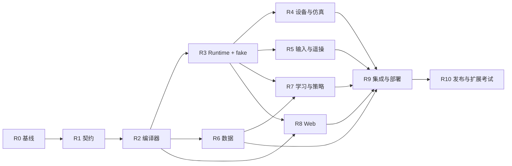

# MORLA 重构任务包与 agent 交接

日期：2026-10-27。实现与验收状态见 [progress.md](progress.md)，下文保留阶段实施规格。本文依赖 [主规格](../COMPOSABLE_ARCHITECTURE_PLAN.md) 与 [验收规格](VALIDATION.md)。任务编号与旧 P0–P11 迁移阶段无关。

## 1. 后续执行规则

1. 先读主规格、当前 Git 状态、本文件和当前阶段的目标文件。比较 `baseline.json` 的源码哈希；代码已变化时记录差异并调整任务，不覆盖用户新改动。
2. 先建立阶段可失败的验收样例，再实现。保留已有 driver/input/data/HITL 行为测试，不为通过测试删保护、填零或缩减维数。
3. 只在 MORLA 仓库实施。第三方 SDK、OpenPI、LeRobot、MORLA-piano 的变更另建可审查 bridge/补丁提案，不未经说明修改外部代码和现场数据。
4. 文档中的目标命令/API 当前不存在。创建后要增加帮助、退出码、错误 JSON、安装资源与测试；不得在交付说明中展示未经运行的命令为实测结果。
5. 缺 Linux/ROS/GPU/设备时继续完成可独立的软件工作，相关项目记 BLOCKED_ENV 或 NOT_RUN，不冒充 PASS，也不阻止所有阶段推进。
6. 真实 enable、HOME、位置动作、固件/总线初始化只在对应设备验收流程与现场授权条件下执行；离线 agent 不自动触发。普通编译、mock、review 无需因此停工。
7. 每阶段交付：可回退 commit/PR、文件清单、接口变化、执行命令/退出码/环境、验收 ID、实际日志路径、失败和未测项、下一阶段交接。
8. 对协议/维度/动作模式等改动，更新契约文档、schema、Python、IDL、TypeScript 和 golden fixture；禁止各自增加临时字段绕过契约。

建议实施时建立 `docs/architecture_refactor/progress.md` 与 `evidence/<阶段>/<运行ID>/manifest.json`。本轮没有预填任何完成状态。日志不携带 token/设备秘密；大文件、视频和数据集放外部 artifact storage，以哈希和路径引用。

## 2. 依赖与里程碑

M1（R0–R3）：新架构 fake 纵向链路可运行，接口/资源/控制权反例通过。

M2（R4–R7）：现有设备适配与多输入、数据、训练配置/策略连通，混合品牌仿真形成闭环。

M3（R8–R10）：Web 自由组合、旧系统迁移、性能与独立审查通过；真实部署逐个验收。

工作量按项目而非小修评估：建议预留约 60–100 个工程人日的软件实施与测试预算，硬件等待、机械适配、GPU 大训练和外部仓库协调另计；这是规划估计，不是工期承诺。R0 后按已有测试复用度、可用后端和未预见接口重新估算。不能用“agent 可并行”消除真实设备串行验收与跨阶段集成成本。

## R0：冻结基线与保护资产

**依赖：无。建议拆为 2 个小 PR：测试/快照基础设施、现场行为清单。**

读取：`morla_core`、`morla_bringup` 的 Profile/坐标/launch/coordinator；机器人 driver 与 teleop；`docs/README.md` 的排障主题；piano 日志与现有用例；训练脚本和外部版本信息。

工作：

- 导出 12 个 Profile 的 resolved JSON、v2 schema/hash、有效 launch 参数、具名 state/action、能力与已知 real/sim 限制，作为只读 golden fixtures。
- 记录原始输入样本、正确关节映射、坐标/TCP/零位、相机指纹、触觉来源、HITL 时序、HOME/workpos 与 enable 反馈等保护。
- 建立最小数据样本：同维旧格式、不同 state/action 维新需求、0 相机、带触觉、不同命名/排列；禁止使用敏感真实视频作公开 fixture。
- 在 ROS-free 与 Ubuntu/ROS Humble 环境分别执行适用旧测试；记录测试未覆盖哪些真实 SDK 行为。建立固定 benchmark 负载和测量方法。
- 盘点外部依赖的可安装来源、commit、Python/ABI/架构，特别是训练环境、XHand SDK、Astral SDK 和 MORLA-piano。
- 把“进程仍活着”与“设备已就绪”基线分开；调查 Astral 的板级 enable/home 对未选关节的影响。

新增目标：`test/fixtures/legacy_profiles/`、`test/fixtures/contract_samples/`、`scripts/test_composable_baseline.sh`、`docs/architecture_refactor/progress.md`。根 `test/` 是计划新增；当前仓库以各包 `test/` 为主，R0 应约定统一 fixture 的安装/定位方式。

验收：B01–B03，以及 B04 的旧系统基线部分（新旧对照在 R9 完成）；原有测试失败有明确分类和复现，不能先批量修改 golden 数值。冻结版本 tag/commit 作为回退点。

## R1：冻结契约与 SDK 骨架

**依赖：R0。建议拆为 3 PR：纯契约、ROS IDL、符合性样板。**

主要文件：

- 新 `src/common/morla_core/morla_core/contracts/{component,assembly,resolved,ports,commands,samples,features,errors}.py`
- 新 `morla_core` 安装资源 `schemas/{component,assembly,deployment,resolved,capture,model}.schema.json`
- 新 `src/common/morla_interfaces/{msg,srv,action}/` 及 package.xml/CMakeLists.txt
- 新 `morla_core/test/contracts/`、插件 reference fixture 与说明

工作：

- 定义 stable instance ID、可选 role、端口/单位/关节类型、来源/质量、错误码与版本兼容规则。
- 定义 ControlMode、CommandEnvelope、Receipt、ActivationPermit、Lease、StopPolicy、operation 状态/幂等/取消语义。明确哪些字段具有权限意义、由谁生成、在哪里检查。
- 定义 ComponentDescriptor/AssemblySpec/DeploymentBinding/ResolvedSystem 与三份数据 Spec；冻结 v3 名称和 hash 规则，旧 v2 类不改变身份。
- 定义 AdapterContext 生命周期、线程/进程边界、设备会话 sharing、非阻塞缓存、有界邮箱、日志与健康接口。
- 明确单位库/验证工具依赖的版本选择；不要引入运行时动态表达式引擎。
- 验证 Python 3.10（ROS Humble）与训练侧 3.12 的纯契约兼容，不使用仅在 3.12 可用的语法/API；核心依赖保持轻量。
- 发布一个最小 fake actuator、fake camera、fake input 的 descriptor/接口符合性样板，任何新插件均可运行同一 harness。

验收：C01–C08、A01–A04；未知字段/缺省语义不能静默猜测；标准字段往返序列化一致。R1 结束进行第一次独立架构对抗审查，再允许并行开发消费者。

## R2：组件目录、装配编译与旧 Profile 导入

**依赖：R1。建议拆为 3 PR：目录与解析、图编译、兼容导入。**

目标文件：`morla_core/plugins/{registry,manifest_loader}.py`、`morla_core/composition/{parser,compiler,graphs,resources,features,hashing,diagnostics,legacy_import}.py`，新增 CLI module；调整 `morla_core/setup.py` 安装 schema/资源/entry points。

工作：

- 纯目录发现不 import 供应商 SDK；ament 与离线 fixture 通过同一 registry API。
- 按主规格八步编译，校验端口/控制/设备/安装与依赖图；诊断带 error_code、JSON pointer、关联实例、修正建议与严重度。
- 编译先得到逻辑 LaunchPlan，不立即调用 ROS。真实设备探测放独立 preflight。
- 实现 deterministic lock/resolution 和原子产物写入；同版本同配置不同进程/hashseed 输出一致。
- 导入现有 12 Profile：保留 v2 原文/hash 与 legacy behavior metadata，生成实例化规格。未能无损表达的配置必须显示 diagnostic，不 silently normalize。
- 保留旧 registry，不把所有旧消费者一口气换到新 JSON。提供 `ResolvedSystem -> LegacyProfileView`，只对可无损表示的组合开放。
- CLI 目标：`morla-system catalog/validate/compile/diff/import-profile`；`--json` 和稳定退出码；所有命令默认无设备副作用。

验收：C09–C16、L01；12 Profile 编译稳定，混合 Nero/Astral 在描述具备时可编译；缺装载/机械/模型能力得到分别可解释的拒绝；0 相机/0 臂在允许场景可表示。

回退：新编译器独立入口，旧 `morla-profile` 继续可运行。

## R3：统一 Runtime、资源锁与命令网关

**依赖：R2。建议拆为 4 PR：状态机/资源、执行器、网关/租约、fake 端到端。**

新增 `src/common/morla_runtime/morla_runtime/`：`session.py`、`lifecycle.py`、`resource_manager.py`、`process_executor.py`、`command_gateway.py`、`authority.py`、`operations.py`、`health.py`、`event_log.py`；纯逻辑与 ROS bridge 分文件。调整 `morla_bringup/launch/` 新增单个 `system.launch.py` 作为已编译计划入口。

工作：

- 状态机不依赖 wall clock，使用可注入时钟测试；失败补偿顺序、超时、重启、进程退出可确定复现。
- 主机资源租约在多个 Web/CLI 进程之间互斥，进程崩溃后锁释放/恢复有确定行为；live 设备锁不能因 Redis/网络依赖故障而丢失，本期使用本地主机方案。
- argv 方式启动受控 node/worker，管理进程组；取消只终止自己创建且身份已校验的子进程，不通过宽泛进程名杀无关任务。
- Gateway 验证 command/session/epoch/sequence/TTL/具名关节/单位/限位，设备驱动仍保留独立约束和看门狗。
- 控制 group 原子授予、部分 dispatch 失败、停止失败、SDK 卡住等可观测，不能无限卡整个系统。
- lifecycle readiness 来自组件状态和真实测量，取消 warmup 秒数后就 RUNNING 的替代判断。
- 新路径保留 disarmed；producer 注册不授予运动权限。所有运行参数快照记录在 session artifact。
- 最小纵向切片：fake input → fake arm → collector fixture → stub policy；R6/R7 未完成时可用测试端点，必须标注临时替身，不声称数据/学习阶段完成。

验收：R01–R12、S01–S10。第一个里程碑必须证明断线和竞争会拒绝新命令；不允许只跑快乐路径演示。

## R4：既有组件适配、几何组合与仿真

**依赖：R3。建议拆成 5–7 PR，按设备隔离，最后单独集成混合场景。**

### R4a Nero

修改 `nero_robot_control/{driver_core,sdk_adapter,driver_node}.py` 与 `morla_nero_robot` manifest。保留 CAN 冷启动、七关节 enable 反馈、J7 prefetch、HOME/workpos trajectory、joint_conventions、手动与流式许可区分。通用操作映射到现有操作实现；不把现有安全流程简化成一个 `enable=True`。

### R4b Astral 共享设备会话

修改 `astral_robot_control/{driver_node,joint_layout}.py`，添加会话适配。将连接、使能、全板操作与逻辑臂/夹爪状态分开；新路径不自动 one_click_ready。单右臂实例不得产生第二个整板 SDK 或误控制未选左臂/头腰。先用 fake SDK 记录所有调用，再在硬件确认哪些命令实际影响整板；若无法隔离，只能声明整板故障/操作作用范围并阻止不安全组合。

### R4c XHand/Wuji/夹爪

复用 `xhand_adapter`、`xhand_control_ros2`、`wujihand_control`、`wujihandros2`；发布标准反馈与传感器 codec。区别 native hand_id、实例 ID 与角色；多手共享 serial/SDK 按实际协议合并。保留 XHand 电流限值、有效反馈、触觉缺失质量；Wuji 左右支持必须分别核对，不能将右手配置复制改名即算左手可用。

Astral 集成夹爪绑定控制板通道；Nero 接不同夹爪若缺真实驱动/电气连接，不伪造 real backend，可先以假组件验证组合接口。接入现有能力是本阶段范围，开发未提供的硬件驱动按独立适配任务处理。

### R4d 相机与其他传感器

在 `quest3_video_streamer/{source_base,ros_source,webcam_source,collect_tap,schemas,scan}.py` 周围注册能力，采集与预览可分别启停。既有 ROS camera source 可复用外部相机驱动；设备序列号/指纹与 semantic label 分开。相机无预览也能录制；慢浏览器不能拖慢采集。

### R4e 几何与组合仿真

新增 `robot_description` 的 composition asset catalog/builder；扩展 `coordinate_contract.py` 为实例图版，旧入口用兼容 wrapper。IK 包保留求解器，实现 adapter 协议。组合 sim 只创建一个场景，在可复用的旧 asset 上加 namespace/mounts，检验 joint/actuator/sensor 对应。缺完整动力学的资产明确降级标签。

验收：A05–A10、G01–G08、矩阵 M01–M10。Nero+Astral 最小混合场景必须有 state/command 元素证据；真机能力未验收时保持不可激活，不影响 fake/仿真里程碑。

## R5：通用遥操与多输入

**依赖：R3；真实 IK 集成依赖对应 R4 适配。建议 4 PR：通用 controller、Quest 迁移、gamepad、mobile。**

文件：新 `morla_teleop/{bindings,controllers,anchors,modes,deadman}.py`；`morla_input/{adapters,protocols}/`；已有 `quest3_udp_mocap.py/packet_guard.py/stream_health.py`；两个 arm teleop 的 pose_processor/teleop node；retargeting；`morla_operator_control`。

工作：

- 先录旧 Quest 输入和输出 golden trace，再搬公共锚定/输入门控；Nero 与 Astral 特有几何留插件。
- Controller 声明输入/输出契约、状态 reset、deadline、重锚行为；不得含 robot_id 分支。
- Xbox 使用固定逻辑轴名，测试按钮回中/重复、设备断连、轴死区、目标切换，提供实际按键配置与用户说明。
- 手机提供最小触屏页面：配对/选择绑定、deadman、两组虚拟轴/标量、停止/采集事件与连接反馈；响应式布局，浏览器 blur/visibility/touchcancel 主动发 release，服务端仍以超时独立防护。
- Quest 和手套同侧输入的冲突以端口 writer 规则处理，不再共享 topic 静默相互覆盖。
- operator router 的 record/start/pause 等迁入会话 scope，语音与脚踏去重/确认保留。

验收：I01–I12、M11–M16；所有 fake 输入可确定回放；至少 Xbox 实体设备和一部手机完成人机 E2E 后才能写这两类输入支持已验收。

## R6：Schema v3 与采集处理全链路

**依赖：R2；在线部分依赖 R3。建议 4 PR：数据视图/codec、采集、对齐/导出、兼容回归。**

关键修改：

- `morla_data_collect/schema.py::FrozenPipelineSchema`：独立 state/action block API，禁止把 action 当 state 别名。
- `data_collect_node.py`、`data_writer.py`：按 stream registry 订阅、codec 解码、snapshot/事件、validity；搬出 XHand 原生特判。
- `pipeline/align_data.py`：按 ActionSpec 建 action，不用 state_dim；分清 requested/dispatched/next_state。
- `convert_to_lerobot.py/convert_to_lerobot_v3.py/convert_to_act.py`：分别生成 state/action names、shape、统计和 metadata。
- `validate_data.py/verify_aligned.py/repair_aligned.py/replay_rerun.py/preview_session.py/intervention.py/artifacts.py`：适配 v3、来源/质量和新 camera/epoch 规则。
- `morla_core/schema.py`：旧版本兼容接口；新 v3 实现可以单独模块，避免不断向旧 dataclass 加隐式字段。

工作：实现无相机/不同 DOF/动作子集/只读传感器、显式旧数据转换、归一化统计按特征键校验。存储 schema 写入开始时冻结；部分完成状态、磁盘满、取消、崩溃恢复可观测。每个导出保留 provenance 与相机预处理契约。

验收：D01–D14；原有 offline suites 加新增 fixture。特别检查 11 state/8 action、38/54 action、非 left/right 命名、三路自定义 camera key，全链路逐元素对照。未经此阶段不能把“可配置 data schema”算作完成。

## R7：学习、推理与回放统一

**依赖：R3/R6；旧 backend 重构可先行。建议 4 PR：训练契约、ACT/OpenPI 配置生成、推理 writer、HITL/replay。**

新增 `morla_learning/{training_spec,model_manifest,projection,environment,backends,cli}.py`；修改 `scripts/act_train.sh/openpi_train.sh/serve_policy.sh` 为调用生成配置的薄 wrapper。训练环境路径通过 config/环境显式传入，去除工作站绝对路径为默认事实来源。

修改 `morla_policy_inference/{robot_io,node,protocol,backend,executor,engine,replay}.py`：ObservationAssembler 与 FeatureMapper 共用核心契约，保留 engine 性能优化；输出走 runtime。旧 ownership ROS topics 可提供观察/兼容桥，但权威只保留一个。

实现模型容量/相机/动作模式/时钟/fps/norm/几何握手，训练参数与 checkpoint 绑定的 manifest。对两个锁定后端分别做 loader + 少步训练/加载检查，GPU 不可用则保留真实训练未验收。

验收：P01–P10、D12–D14；正负模型握手、超过容量、同维不同语义、过期 chunk、HUMAN 接管和释放、旧 v2 replay、policy 断连停止。不得为了让旧模型加载而关闭全部 hash 验证。

## R8：Web 配置器与动态监控

**依赖：R2/R3；UI 原型可以早做，运行 E2E 依赖 R4–R7。建议 4 PR：API、配置编辑、运行监控、E2E。**

后端：将 `web_server.py` 按路由拆为 assemblies/sessions/components/training，把业务逻辑下沉服务层；`launch_manager.py` 成为 runtime client/legacy adapter；`monitor_node.py` 按 resolved streams 建订阅。`config.py` 不再堆品牌专用状态。

前端：`types.ts`、`api/client.ts`、`App.tsx`、`SystemTab.tsx/ControlBar.tsx/JointPanel.tsx/DataCollectCard.tsx/InferenceCard.tsx/VideoCard.tsx` 接入动态 schema；新增 `AssemblyEditor/ComponentCatalog/BindingEditor/ContractPreview/PreflightPanel`。保留 PianoTab 的功能，通过隔离桥调整控制权。

工作：只读目录、创建复制、typed 表单、兼容诊断、显式保存版本、运行前预览、任务/组件状态、相机/键名/维度预览、WebSocket 断线重连、并发编辑冲突处理。后端验证所有约束，前端错误提示不能替代检查。

测试：现有 package.json 只有 dev/build/preview，没有完整 UI 测试入口。新增并锁定 Vitest/Testing Library 或同等组件测试工具、Playwright E2E；保留现有 `.cjs` piano node tests。`npm ci && npm run build` 只证明构建，不等于交互通过。

验收：W01–W10；从空配置到混合系统的浏览器 E2E，以及缺插件、缺标定、操作失败、换 revision、后端重启。同一 YAML Web/CLI 产物 hash 相同。

## R9：系统迁移、性能与部署验收

**依赖：R4–R8。建议按软件集成与每套硬件部署分别提交证据，不合成一个“全通过”。**

工作：

- 逐个旧 Profile 在新路径比对具名动作、反馈、数据、启动参数和功能；允许的差异仅是已记录协议/namespace/启动安全改进。
- 旧入口增加明确 deprecation 与互斥，不使用 silent fallback。检查机器人专用逻辑是否已全部归属插件/compatibility，而非被复制进 runtime。
- 独立 reviewer 按 VALIDATION 红队用例攻击；测试卡死 SDK、存储/编码负载、策略网络停顿、手机锁屏、控制板部分失败、资源双开。
- 固定硬件/输入/负载采集基线与新实现 p50/p95/p99/max，长稳 soak；拒绝通过无限增大 TTL 掩盖超时。
- 真机逐组件 → 单臂单末端 → 双臂 → 混合品牌低速 → 完整业务；每一级检查停止/反馈/限位/坐标后才能进入下一步。
- legacy piano 与新 runtime 互斥验证；如外部 piano 已授权改造，另测其 writer 桥，无证据不得移除隔离。

验收：L01–L05、B04、S11–S16、全部适用 matrix；所有阻断问题关闭，真机未满足项清楚展示。

## R10：扩展考试、清理与发布

**依赖：R9 软件验收。硬件未测项目可保持受限发布，但不能标作完整 real 支持。**

让未参与核心编写的执行者仅根据 SDK 文档，添加一个新品牌 fake arm、一个不同维度 sensor、一个非 VR input。在核心冻结 commit 上安装插件并用新 AssemblySpec 完成遥操/采集/导出/replay，公共包零品牌分支修改。记录耗时与文档缺失；此项检验“以后只需实现统一接口”的真实成本。

清理已无消费者的 fixed launch 分支、重复 schema 与状态转换；继续保留历史数据读适配器。更新 README/profile_reference/TODO、安装指南、组件开发指南、Web 操作指南、硬件能力矩阵、迁移/回退示例和版本说明。不要为了目录整齐移动全部第三方 SDK。

验收：E01–E03；公布按 backend 与设备的功能状态，而非一个笼统“支持全部机器人”。

## 3. 多 agent 分工建议（供用户后续执行）

当前计划阶段没有启动执行 agent。后续可按用户选择采用以下分工，先 R0/R1 定契约，再并行：

- Agent A：core contracts/compiler/兼容，维护唯一 schema 和接口变更日志。
- Agent B：runtime/gateway/resource/session + 设备适配；涉及 Astral 共享会话时可再按设备拆，但不得并发改同一核心状态机。
- Agent C：input/teleop/IK bridge 与手机/Xbox。
- Agent D：data/learning/policy；R6 与 R7 共用 mapper，不能各写一份。
- Agent E：Web/backend facade/UI/E2E；使用契约生成类型。
- 独立 Reviewer：只读审查与故障复现，避免作者自证；缺陷修复交作者，reviewer 再复测。

实际只有少量并发槽时先 A+B，契约稳定后 C/D，最后 E 集成。共享文件必须由一个 owner 集成；不让多个 agent 同时重写 schema.py、node.py 或 web_server.py。独立分支/worktree 的提交按依赖顺序合并，合并后的集成测试不能由分支单测替代。

## 4. 可直接交给执行 agent 的启动提示

> 在 MORLA 仓库实施可组合架构重构。先阅读 docs/COMPOSABLE_ARCHITECTURE_PLAN.md、docs/architecture_refactor/EXECUTION.md、VALIDATION.md、baseline.json 和当前 progress/Git 状态。当前任务仅为 R__，其依赖必须已有可验证证据。先建立本阶段的失败样例，再实施该阶段约定的文件与接口。保留旧 Profile/Schema/数据和现场保护；禁止静默 fake 回退、填零、截维、绕过租约或关闭握手。完成阶段所列验收，记录实际命令、环境、退出码与日志；缺设备/ROS/GPU写未测，不写通过。不要启动真实电机，不修改外部 SDK/学习仓库/现场标定。按本文提交可回退的小改动，并提供独立 reviewer 能复现的证据和下一阶段交接。发现设计冲突时提交具体问题、失败样例和最小 ADR 修订，不能自行另起一套无兼容架构。

Reviewer 提示：

> 对 R__ 当前 diff 做独立对抗审查。以 VALIDATION.md 的适用用例和不变量为准，从驱动边界实际命令、数据元素和持久化快照找证据，不接受作者的成功日志替代。重点尝试绕过资源锁/命令权、改变 epoch/时钟/顺序、制造部分启动与停止失败、同维异义和 state/action 不同维、任意相机键和缺模态。不要修改产品代码；给出最小复现、影响、严重度、定位、应有行为和验证修复的方法。只有复测关闭的阻断问题清零才建议进入下一门禁；未测试的硬件行为独立列出。
