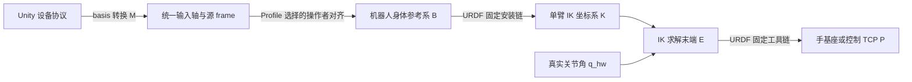

# MORLA 坐标、关节零位与工具链统一优化计划

日期：2026-10-14（Asia/Shanghai）。状态：**坐标与运动学软件实施、数值验证和仿真数据闭环已完成；真实设备 frame/安装/TCP 验收待硬件条件**。

本文回答并规划四项需求：Quest/Unity 转换统一管理、Nero 双臂共同身体参考系、Nero–connector–XHand 工具变换、仿真 J2 与真实 J2 零位不一致。执行本文时先完成关节与末端约定核对，再迁移坐标配置，最后开放经过验收的工具控制。未来高自由度组合式装配仍见 [TODO.md](TODO.md)，本次为其提供坐标与运动学契约基础，不扩展为整个组合装配系统的实现。

实施时保留清楚的设备边界：活动模型已恢复真实关节零位，Nero 解析 IK 与 Profile 活动裸臂控制目标都使用 `*_link7`。URDF 中 `*_gripper_flange` 是 link7 后的命名物理法兰帧；固定链可用于 TF、SDK 实测法兰 pose 的 frame 核验，或显式选择法兰/外接工具作为控制目标。`connector`、`hand_link`、`hand_ee_link` 属于法兰之后的外接组件/手部参考帧。SDK `get_flange_pose()` 与 URDF frame 的坐标对齐仍待只读核验。

本次已实施的运行时修改、数值与整链路证据见 [实施审计 JSON](coordinate_kinematics_audit_2026-10-14.json) 和 [迁移日志](migration_progress.md)。下文源码审查与 FK 数值表是修改前冻结基线，作为行为变化依据保留；不得当作当前活动 URDF 的状态。

## 1. 设计结论与优先级

| 问题 | 结论 | 修改方向 |
| --- | --- | --- |
| Unity 转换与左右臂矩阵分散 | 数学上可以分层组合；目前参数有多份且含义依赖包名，维护和切换容易出错 | 输入包只处理设备坐标约定；物理安装来自最终机器人模型；Profile 统一声明输入对齐、求解器与工具，公共解析器生成有效变换 |
| 双臂基座是否改为身体基座 | 整体 URDF 已有共同 `t_bracket_base`；保留各单臂 `*_base_link` | 用共同身体/装配参考系统一上层位姿；IK 前转换到各求解器局部坐标系，不重写单臂解析 IK |
| connector 是否需要矩阵 | 需要完整 SE(3) 工具链；URDF 已经有相关固定关节 | 从固定关节链提取工具变换；区分解析 IK 末端、物理法兰、连接器、手基座和实际 TCP |
| J2 仿真零位与真实零位不同 | 用户确认真实 J2=0 水平、当前仿真 J2=0 下垂；源码与 FK 核对支持存在约 π/2 的零位偏移 | 以真实关节角为在线标准，优先恢复活动 URDF/MJCF 的真实零位；下垂姿态用显式仿真初始关节值表达 |

优先次序：关节零位和求解器末端 → 非零 TCP 重锚修正 → 公共坐标契约 → 输入/Profile/launch 迁移 → 描述/TF/工具控制 → 数据、策略和 Web 适配 → 仿真与真机验收。

## 2. 修改前冻结基线审查事实

### 2.1 输入与 Astral/Nero 映射

- 原 XNero 的 `quest3_hand_mocap` 发布 Unity 腕位姿；其左右 `nero_teleop_*.yaml` 的 `vr_to_arm_rot` 分别映射到单臂局部基座。
- MORLA `morla_input/quest3_udp_mocap.py` 对位置和方向使用 `UNITY_TO_ROBOT`，姿态矩阵使用 `M R Mᵀ`。当前输出轴约定为 X 左、Y 后、Z 上；这是设备归一化约定，不能因此把输出位置当作已标定的机器人身体位置。
- Astral **确实读取并使用** teleop 的 `vr_to_arm_rot`，当前配置默认是单位阵，所以正常路径看起来只有输入包在转换。`analytic_dh` 路径另外乘 `_R_BASE_T`，这是求解器坐标约定适配；URDF/geometric 路径使用单臂 `*_base_link`。
- Astral 整体 URDF 的左右肩部固定关节 `rpy=0`，因此两个单臂基座与身体参考系方向相同，但原点不同；Nero 两臂的基座方向与原点均不同。
- MORLA Nero 的矩阵已迁为 `A_new = A_old Mᵀ`，参数名为 `vr_to_arm_rot_after_unity_to_robot`；现有坐标等价测试验证了这一代数关系，不能将旧 XNero 矩阵直接再次作用到 MORLA 输入。
- Nero 矩阵同时出现在组件模板、展开的机器人 Profile 和 teleop YAML 中。当前 `nero_xhand_stack.launch.py` 启动 teleop 时只传 `teleop_params_file`，没有用 Profile 中的矩阵覆盖。因此修改 Profile 那份矩阵不保证改变运行行为。
- 输入的 `robot_body` 实际表示 Quest IOBT 的操作者 hips/body 参考系，**不是实体机器人身体**。必须处理这个命名歧义。

### 2.2 整体 URDF 已有共同装配参考系

当前树：

```text
world
└── t_bracket_base                       固定高度 0.860 m
    ├── left_base_link                   xyz=(0,-0.1975,0), rpy=(+1.5708,-1.5708,0)
    │   └── left_joint1 … left_joint7
    │       └── left_link7 → left_gripper_flange → left_connector → left_hand_link
    └── right_base_link                  xyz=(0,+0.1975,0), rpy=(-1.5708,-1.5708,0)
        └── right_joint1 … right_joint7
            └── right_link7 → right_gripper_flange → right_connector → right_hand_link
```

这不是两个不连通的 URDF。以局部基座求 IK 与整机存在共同参考系可以同时成立。`world → t_bracket_base` 是场景放置；`t_bracket_base → *_base_link` 是物理安装，二者不能混进 Quest 轴转换。

### 2.3 J2 与解析 IK 的核对

URDF 明确写有“J2 origin 增加 90°，令 J2=0 时手臂下垂”的注释。两侧 J2 当前 origin 为 `rpy="0 1.5708 -1.5708"`，限位为 `[-3.3108, 0.1692]` rad。当前 sim 直接将标准臂命令写入 MJCF qpos，并将该 qpos 作为标准状态发出；没有做此零位换算。资产 manifest 的相关关节映射也都是 `sign=1, offset=0`。

只读核对使用原点变换与关节轴逐项计算 URDF FK，并用 Pinocchio 独立复核；随机种子 `20261014`，每侧 500 个解析 IK 限位范围内的随机姿态加一个零位。结果见 [审查证据 JSON](coordinate_kinematics_audit_2026-10-14.json)：

| 比较 | 两侧核对结果 |
| --- | --- |
| 当前模型 `q_model,2 = q_hw,2 − π/2` 后，URDF `*_link7` 对解析 FK | 最大位置误差约 `1.164e-5 m`（0.0116 mm）；最大姿态误差约 `5.302e-6 rad` |
| 手工 URDF FK 对 Pinocchio | 最大位置/姿态误差小于 `1e-14`（m/rad） |
| 当前 URDF 同一个未经换算的 q=0，`gripper_flange` 对解析 FK | 位置差约 0.8435 m、姿态差约 90°；此比较同时包含零位及不同末端 frame，不等于实测硬件误差 |

结论：现有解析 FK 在关节零位换算后对应 `*_link7`，并非直接对应 URDF `*_gripper_flange`。解析求解器源码不读 URDF；`resolve_robot_asset()` 目前只核对资产可定位，不会让 DH 运动学自动跟随 URDF 改变。原 P10 的命令、状态和数据闭环证据不能代替这一 FK 几何一致性检查。

### 2.4 工具链与非零 TCP 重锚问题

当前模型给出两侧相同的名义固定关节：

```text
link7 → gripper_flange : xyz=(0.032,0,-0.0235), rpy=(-1.5708,0,-1.5708)
gripper_flange → connector : identity
connector → hand_link : xyz=(0,0,0.028), rpy=(0,0,3.14159)
hand_link → hand_ee_link : xyz=(0,0,0.065), rpy=(0,0,0)
```

因此 `gripper_flange → hand_link` 是约 28 mm 加绕 Z 180°；若以当前解析 IK 对应的 `link7` 为出发点，完整 `link7 → hand_link` 近似为：

```text
[ 0 0 1   0.0600 ]
[ 1 0 0   0      ]
[ 0 1 0  -0.0235 ]
[ 0 0 0   1      ]
```

Nero 当前活动控制目标帧是 `link7`；其后 `link7 → gripper_flange` 固定变换为 `(32, 0, -23.5) mm / (-90°, 0°, -90°)`，来自当前组合 URDF。再后的 28 mm `connector → hand_link` 描述 XHand 安装链，65 mm `hand_link → hand_ee_link` 是手模型的辅助末端参考帧。不能把 28 mm 单独当作 link7→flange 偏移，不能从 mesh visual origin 推断关节变换，也不能仅凭 `hand_ee_link` 名称将其认作抓取 TCP。实际 connector 尺寸以及 SDK flange 的 frame 对齐仍待资料/测量。

另外，Nero `_capture_anchor()` 和 Astral 的多处 anchor/init 路径直接保存 `ik.fk(q)`，而控制循环把该锚点当作 TCP，再右乘工具逆变换。当前工具为单位变换时这个问题被遮蔽。若直接启用上述 hand_link 工具链，零输入增量也会改变首帧 IK 目标。证据 JSON 给出 Nero 相应数学偏差；本次未启用工具或执行机器人动作。

## 3. 坐标和关节契约

### 3.1 统一记号

全文 `ᵃT_b` 表示将 b 系坐标表达成 a 系坐标的 4×4 刚体变换；列向量，右侧先作用，长度 m、角度 rad、四元数 xyzw。代码命名采用 `T_target_from_source`，避免含糊的 `to_robot`。区分：

| 对象 | 含义 | 管理来源 |
| --- | --- | --- |
| U | Unity 原始左手轴约定 | 输入协议适配器 |
| C | 设备归一化右手轴约定 | `morla_input` 的版本化 basis contract |
| S | 归一化后的 Quest tracking-world 或 operator-body 参考系 | 输入消息与 input epoch |
| B | 机器人身体/装配参考系 | Profile 引用最终 URDF frame |
| Aᵢ | 第 i 个机械臂物理局部基座 | URDF 固定安装链 |
| Kᵢ / Eᵢ | IK 内部基座 / IK 求解末端 | 求解器适配契约 |
| Fᵢ / Hᵢ / Pᵢ | 物理法兰 / 手基座 / 控制 TCP | URDF、工具声明及实测标定 |
| q_hw | 驱动、状态、在线动作的真实关节角约定 | 硬件关节契约 |

### 3.2 手性转换与刚体变换分开

当前 `UNITY_TO_ROBOT` 的 `det(M)=-1`，是左右手坐标的 basis 变换，不是可用 TF 四元数表达的刚体旋转。输入层继续执行 `p_C=M p_U` 和 `R_C=M R_U Mᵀ`；禁止将 M 填入普通 `TransformStamped` 或直接当四元数转换。

后续机器人安装与对齐矩阵必须是合法 SO(3)/SE(3)：有限值、正交、`det(R)=+1`、4×4 最后一行合法。输入手性适配是明确的例外，不允许普通配置以此为理由接受反射矩阵。

本次先保留当前输入轴约定和数据数值以降低迁移扰动，改成明确的 `quest3_canonical_legacy_v1` 契约。新机器人身体 frame 建议采用 ROS 的 X 前、Y 左、Z 上；既有 bracket 或 CAD frame 若不符合，保留为明确的非标准模型 frame，通过固定旋转连接到标准身体 frame，不能只改名而不改语义。参考 [REP 103](https://github.com/ros-infrastructure/rep/blob/master/rep-0103.rst)。

### 3.3 源 frame 必须真实

规划新名称为 `quest3_tracking_world_canonical`、`quest3_operator_body_canonical` 和明确属于输入设备的手部局部 frame。兼容旧 topic 时分阶段迁移 frame_id；消费者先识别契约和版本，再迁移名称，不能将旧 `robot_body` 当作实体机器人 body。

tracking world 的起点、操作者身体、机器人身体彼此不是天然重合。增量遥操作采用版本化的“操作者轴对齐”，绝对位姿控制另需完整位置与姿态标定；未标定平移时只能使用增量模式，不能伪造完整绝对 TF。IOBT 模式保留身体相对操控意图；不得因盲目转到 world 而改变“操作者转身后仍相对身体控制”的行为。

## 4. 统一管理方式

统一的是**配置入口、几何来源、解析计算和运行时契约**。输入手性、真实安装、操作者对齐、求解器适配、工具标定各有含义，不合并成一张无人能解释的左右臂矩阵。



### 4.1 单一几何来源

- 机械安装和 connector 几何的名义值来自最终实例化 URDF；MJCF 从同一份模型生成。
- Profile 的 coordinate 配置只引用 `body_frame/base_frame/solver_tip/tool_frame` 等名称和模型 ID，不再重复抄写已有 URDF 固定关节矩阵。
- 如实际安装需要标定覆盖，版本化 installation calibration 必须先生成与之对应的最终 URDF/描述契约，再被 solver、TF 和仿真共同使用。禁止只覆盖 TF 而让模型、IK 和工具矩阵仍使用旧几何。
- `robots.yaml` 仍作为 Profile 索引；完整坐标配置放机器人配置包，由公共解析器解析并冻结。

规划字段示例（不是当前可执行配置）：

```yaml
coordinate_profile:
  package: morla_nero_robot
  path: config/coordinate_profiles/nero_t_bracket.yaml
```

对应配置包括 `coordinate_contract_version`、`assembly_model_id`、`robot_body_frame`、输入 basis/version、tracking-world 与 operator-body 两种增量对齐策略、各臂的 solver adapter ID、base/tip/flange/control frame 和工具验收状态。Nero Profile 的活动裸臂控制目标是 `*_link7`；需要控制法兰之后的 XHand/夹具任务点时，才显式选择对应 connector、hand 或 task TCP，并从 URDF 固定链解析变换。

### 4.2 公共解析与运算

规划在 `morla_core` 增加 ROS-free `coordinates.py`、`coordinate_contract.py`，负责严格变换验证、组合/求逆、固定关节路径解析、关节映射和 `ResolvedCoordinateContract`。ROS 发布与动态 TF 查询放 bringup 的独立桥接层，不向纯逻辑模块引入强制 rclpy 依赖。

解析器输出：有效输入到 IK 的旋转、B 到各基座/求解器的变换、求解末端到 TCP 的变换、关节约定及映射、来源与标定状态、contract version/hash。launch、teleop、data、policy、Web 读取同一份解析结果。

固定变换启动时冻结并缓存。动态数据按消息时间查询；缺失、过期或不符合契约的 frame 不允许回退成单位变换。Profile、安装配置、工具、标定或输入 epoch 变化时，先冻结所有命令写入者，清空过滤器、锚点及旧策略 chunk，再显式重新 start/re-anchor。

## 5. 四项需求的具体改造

### 5.1 Unity 映射与机器人切换

当前矩阵：

```text
M   = [-1  0  0; 0  0 -1; 0 1 0]
A_L = [ 0  0  1; 0 -1  0; 1 0 0]
A_R = [ 0  0  1; 0  1  0;-1 0 0]
```

若以现有 `t_bracket_base` 为 B，将左右 mount 的旋转分别乘 A_L/A_R，两侧都近似得到：

```text
R_B_from_C ≈ [0 1 0; -1 0 0; 0 0 1] = Rz(-π/2)
```

这说明现有左右矩阵可拆成“一个公共对齐 + 两个真实安装的逆旋转”。URDF 使用四舍五入的 `1.5708`，两侧推导结果最大元素差约 `7.35e-6`；不能宣称浮点意义完全相同。行为兼容期保存精确 legacy 等效值或显式记录小残差，再以验证容差对比。该公共旋转是当前模型与历史控制矩阵的代数推导，不是重新实测的身体朝向标定。

改造步骤：

1. 输入中给 M 明确命名、来源与契约版本；清理活动实现与 standalone 的重复轴变换，保留旧导入 API 的明确兼容方式。
2. 从 Profile coordinate config 和最终模型求得 `R_K_from_S`；Astral 与 Nero 都由同一个解析入口提供有效矩阵。
3. 原 `vr_to_arm_rot` / `vr_to_arm_rot_after_unity_to_robot` 在过渡期作为显式 legacy 参数保留；coordinate contract 与 legacy 参数冲突时拒绝启动，不采用不透明的“最后一个参数覆盖前一个”。
4. launch 传解析后的参数或契约给 teleop；删除组件/Profile/teleop YAML 中互相竞争的手抄矩阵。输入层不因切换 Astral/Nero 而换手性矩阵。
5. Astral 的 `_R_BASE_T`、关节 sign flip 和 init/workspace frame 放入求解器适配边界，不混入操作者标定。
6. 对输入 mode、frame_id、contract version 和 input epoch 做一致校验；未知 frame 不能仅因为与上次字符串相同就被接受。

### 5.2 共同身体参考系与 IK

优先让 `robot_body_frame` 引用现有 `t_bracket_base`，保留局部 `left/right_base_link`。如需要统一的标准 `robot_body_link`，在确认实物前方和 CAD 轴后添加固定参考 frame，并严格保持已有 link 的世界几何关系。不用强行删除局部基座，也不重新解释单臂 DH 杆长、关节轴或 SDK 的原点。

给定身体系中的 TCP 目标：

```text
ᵏT_e,target = inverse(ᵇT_k) · ᵇT_p,target · inverse(ᵉT_p)
ᵇT_p,current = ᵇT_k · FK_K_E(q_hw 经求解器适配后的值) · ᵉT_p
```

只在 solver 外包一层输入/输出转换。Nero 解析 IK 保持局部基座求解；Astral 的 clean-DH 与 URDF/geometric 由各自适配契约处理。

增量模式必须继续使用：

```text
Δp_K = scale · R_K_from_S · (p_S(t) − p_S(t0))
ΔR_K = R_K_from_S · (R_S(t) R_S(t0)ᵀ) · R_K_from_Sᵀ
```

位置增量是向量，不重复减基座安装平移；绝对位姿则要完整 SE(3) 变换。将 pose 变换到新父系时旋转左乘；方向增量换基时使用共轭，二者不可混用。保持现有尺度、滤波与重锚交互；滤波时常数优化另行排期。

workspace/safety 的球心、轴向盒约束和姿态目标都要声明检查 frame；不能在 body 下生成目标后直接用 arm-base 的数值边界夹紧。全身/双臂协同 IK 不属于本次必需重构。

### 5.3 connector、手基座与 TCP

1. 在运动学契约中区分 `solver_tip_frame`、`physical_flange_frame`、`hand_base_frame`、`control_tcp_frame`。当前 Nero 的 IK solver tip 与活动裸臂控制 frame 都是 `*_link7`；`*_gripper_flange` 保留为其后的物理法兰命名帧。SDK `get_flange_pose()` 返回 frame 与 URDF flange 的原点/轴向映射仍需只读核对。
2. 完整工具关系由 `E → F → connector → H → P` 的固定链相乘得到。不在 teleop YAML、Web 与 data 各维护一个 tcp_offset。
3. 修正 Astral/Nero 全部初始化、start、HOME 后恢复、工作位、re-anchor、prepare/HITL anchor 路径：先算真实/模型末端，再右乘工具变换得到 TCP 锚点；控制循环最后再乘工具逆变换。零增量必须还原原 IK 末端目标。
4. 优先采用命名 tool frame；对手工工具标定偏移，必须声明父系、m/rad、四元数或固定轴 RPY、来源、版本及验收状态。未知工具不能默认为已标定。
5. Nero driver 的旧 `/.../tcp_pose` 实际发布 SDK flange 数据，名称容易误解。规范接口为 `/.../flange_pose`，旧 `/.../tcp_pose` 只作 deprecated 同值兼容别名；`header.frame_id` 是父 base，child flange frame 从 Profile 声明。状态和文档明确 SDK 来源及 frame 对齐验收状态。仿真通过标准 URDF TF 提供 modeled flange，实机通过 flange pose topic 提供 measured flange；不得混淆来源。
6. XHand 指关节 retargeting 继续处理手部局部 21 点；connector 变换服务于机械臂末端空间控制与整机几何，不把它重复乘进所有手指局部 landmark。

### 5.4 J2 零位统一

在线标准明确为 q_hw：driver、标准 JointState、teleop、策略 action、采集 state/action、回放及当前活动仿真均使用真实关节角。各臂安装姿态只由 mount 固定关节表达。

**推荐方案：恢复活动 URDF 的真实关节零位。** 按当前数值关系，对 J2 的模型 joint origin 做等价修正：

```text
O_hw = O_legacy · Rot(axis_J2, −π/2)
```

对应当前 axis=(0,0,1)；也可核对并恢复注释中的厂商原 origin `rpy="1.5707963 3.1415926 0"`。比较旋转矩阵而不是比较 Euler 字符串。恢复后，同一个 q_hw 应使 URDF `link7` 与解析 FK 一致，活动 sim 不再额外偏移 J2。

同时把模型关节限位转换回真实约定。现有 `[-3.3108,0.1692] + π/2` 约为 `[-1.7400,1.7400]`，与解析/driver 的 `[-1.74533,1.74533]` 有小差异；需确认权威来源，暂用明确的保守交集，禁止因为坐标改造扩大限位。其它关节也逐一核对 sign/offset/limit。

原下垂显示姿态可在仿真初始值中设 `q_hw,2=+π/2`（其余关节按选定姿态填写），并记录为 sim-only 初始姿态；或使用经过确认的 Profile ready pose。不能将这个仿真初始值自动发送到真机。零位、ready pose、HOME、当前状态是不同概念。

历史模型保留为明确的 legacy model revision。必要兼容时可使用 `q_model,2=q_hw,2−π/2`，且状态逆映射与限位也必须一致；该方案只用于旧模型适配，不能同时又恢复 joint origin，造成双重补偿。新活动链采用真实零位模型和单位关节映射。

## 6. 已实施的包与文件

| 位置 | 已完成的实现 |
| --- | --- |
| `morla_core/coordinates.py`、`coordinate_contract.py` | 刚体/旋转矩阵严格校验、变换求逆/组合、URDF 固定链、输入安装派生、工具链解析、solver adapter 标识与确定性 `kinematics_hash` |
| Profile/schema 与 12 份机器人 Profile | 统一 basis/frame/body/arm solver/tool 声明；description revision 和运动学语义参与 schema/hash；删除重复的左右 teleop 输入矩阵 |
| `morla_input` 在线和 standalone Quest 输入 | 使用同一 Unity basis 常量，声明版本/hash；将 Quest tracking world、operator body 与机器人装配身体 frame 分开标记 |
| `morla_bringup` 各 Profile launch | 从 Profile 和最终 URDF 派生左右 solver-base 输入旋转与 solver-tip→tool 变换；给 Astral/Nero teleop 注入同一版本及 hash |
| `profile_state.py`、`profile_joint_state_bridge.py` 与 `robot_state_publisher` | 每个 arm Profile 装配 URDF publisher；将实际测量关节状态按名字映射到 URDF 并发布 TF；状态桥不订阅 command、不合并不同时间戳的异步状态、不伪造反馈 |
| Astral/Nero teleop 节点和 launch | 所有 anchor/init/re-anchor/HITL 锚点均按 TCP FK 保存；目标回到 solver tip 后求解；完整 4×4 参数为 ROS double array，兼容工具矩阵和 standalone legacy `tcp_offset` |
| Nero 活动 URDF、MJCF、manifest 与 Profiles | 恢复硬件关节零位/角限位；旧偏置模型归档至 `legacy/`；从活动 URDF 重生成 MJCF；sim 初始下垂姿态保存在 sim 配置，标准状态/命令保持硬件角 |
| 数采、policy/replay、Web | raw/export 保留 coordinate contract/hash；策略握手与 replay 校验运动学 hash；Profile API/UI 展示 basis、body、solver/tool 和标定状态 |
| 回归 | 坐标与非零 TCP 变换测试、双侧 URDF/MJCF FK 随机核对、profile-state 测试，以及 ROS、policy、offline、仿真采集导出入口已接入并通过 |

URDF 固定关节由 `robot_state_publisher` 发布到 `/tf_static`，可动关节使用测量状态生成 `/tf`。一条静态边只有一个发布权威，不同时重复广播。当前桥按每个输入源分别发布一条保留原测量时间戳的部分 `JointState`，不合并不同周期的异步消息；状态频率与完整度在 `/robot/kinematics/status` 报告。没有把目标角当成测量反馈。

## 7. 数据、策略与历史兼容

现有 `FrozenSchema.schema_hash` 排除了 metadata；仅更新 `description_revision` metadata **不能保证**模型或回放能发现运动学变化。新增显式 `kinematics_hash`（相关模型、关节零位、sign/offset、固定链、solver/tip/tool 语义）和标定版本信息；输入会话的重锚/对齐信息独立记录，不因每次按 start 就改变机器人运动学版本。

channel/layout 没变时可保持 `layout_hash`；改变关节数值或 Cartesian frame 语义时必须版本化，不靠字段数量相同判断兼容。模型握手、日志和数据 meta 保存该契约；Cartesian policy 明确目标父系、TCP、单位和绝对/增量含义。旧后端接入走显式版本兼容和验收流程。

旧 XNero/MORLA 数据保留原始文件和来源 SHA。逐类区分 real hardware、旧模型 sim、来源未知；不能对所有旧数据统一加/减 π/2。旧 sim 的图像、关节状态、命令与被修改的模型共同定义语义，只改关节列并不自动修复图像与动作关系。无法确认的旧 sim 段标记运动学兼容性未知，经过审查后才用于新物理约定训练/回放。迁移工作副本保存旧/新契约和转换报告，禁止覆盖原段。

本计划对旧几何的修正属于有意行为变化；它不是“装配重构必须几何不变”的例外漏洞。需保存修正前证据、预期差异与新版本。硬件 SDK 的角值与命令保持真实约定；如果新校准修改了真实安装朝向，旧模型兼容性也要重新确认。

## 8. 分阶段执行与验收

软件阶段均已在同一工作区完成并复验。由于修正零位本身会改变模型语义，版本 hash、legacy 模型、数值 FK 和数据来源状态都保留；仿真/软件测试不能代替实体安装和设备验收。

### C0：冻结与核对（完成；设备资料项待验）

- 冻结当前 HEAD、上述源码 SHA、12 个 resolved Profile/schema、URDF/MJCF、旧映射和模型来源。
- 将本次临时只读 FK 核对固化成可重跑的测试/审查入口；包含原点、axis、末端选择和关节映射，避免只比较旧/新拷贝是否相同。
- 核对 SDK 中 q=0、法兰 frame、RPY 顺序与单位；实物暂不可用时记录待核验，数学阶段可继续但不开放真机工具运动。

软件完成标准：q_hw/q_model、URDF base、solver tip、物理 flange、XHand connector/hand frame、来源与状态均有明确声明。裸臂活动目标保持 solver tip/link7；SDK flange pose 与 URDF flange 的实际对齐及 XHand/task TCP 尺寸仍待设备资料补齐。

### C1：J2 与模型零位（软件完成）

- 备份 legacy revision；优先恢复活动 URDF 的真实零位与合理限位，重生成 MJCF，更新 manifest 及 Profile description revision。
- 保持标准 q_hw 无偏移；仅旧模型适配器应用一次偏移与逆映射。
- 用仿真初始姿态表达下垂，不改物理 mount 来抵消关节零位。

完成标准已通过：两侧各 501 个零位/随机关节姿态下，解析 FK、URDF 和 MJCF `link7` 在位置、姿态建议容差内一致；新的回归进一步核对解析 FK 乘 link7→flange 后与 URDF/MJCF flange 一致。sim qpos/标准状态/命令使用 `q_hw`。真实安装标定另待设备验收。

### C2：工具与全部 anchor（软件完成；实体 TCP 待验）

- 新增非零平移+非零旋转工具的 start/re-anchor/HITL 回归，覆盖 Astral 与 Nero；修正所有锚点路径。
- 从模型求出 solver-tip→控制末端；Nero 默认使用 `*_link7`，`gripper_flange`、`hand_link`/`hand_ee_link`/任务 TCP 可作为显式命名 frame 选择。

软件完成标准已由变换闭环和非零工具 re-anchor 回归通过。Nero Profile 活动工具是 link7，因此默认锚点与 IK frame 重合；显式选择命名 URDF flange/tool frame 时，通用锚点与逆变换路径可处理对应固定链。任务级 hand/TCP 仍需独立配置；SDK frame 映射和实体偏差验收待设备条件。

### C3：公共坐标契约与 Profile 注入（完成）

- 实现公共解析器、有效变换及诊断，迁移输入命名、Astral solver adapter 和 Nero launch 的实际参数来源。
- 对左右历史矩阵建立精确兼容/残差记录，再从共享对齐与实际 mount 派生；不手抄另一套表。

完成标准已通过：canonical basis 与左右安装派生可复现；旧 Nero 矩阵代数等价测试通过；有效值由 Profile 解析后经 launch 注入 teleop；不存在另一份生效的 teleop YAML 左右矩阵。

### C4：TF、状态与真实工具语义（软件完成；实体语义待验）

- 统一单一 TF 发布、命名状态聚合和 body/flange/tool pose；所有消费者使用一致最终模型。
- 对真实安装、connector、SDK flange 与 TCP 做只读姿态/尺寸核对，明确名义或已标定来源。

软件完成标准已通过：全部 12 个 Profile 能构造状态桥和 RSP；状态桥只接收实际状态 topic，按名重排且保留输入时间戳；Astral 标量夹爪 command 不进入 joint state。Web/运行时展示 Nero `link7 → gripper_flange` 以及 SDK pose 映射待核验状态。

### C5：数据、策略与 Web（完成）

- 实现 kinematics hash、来源、frame、工具语义和历史版本记录；适配数据导出、policy/replay 与 UI 状态。
- 保持控制 coordinator、writer freeze/ACK、prepare/token、暂停/恢复和 input epoch 的约束；变化时丢弃旧命令缓存。

完成标准已通过：运动学 hash 进入 data contract、policy handshake/replay 和 Web Profile 状态；相同 layout 的不同运动学版本不会静默匹配；非零工具锚点回归和 Web 类型/构建检查通过。

### C6：整链路与设备验收（软件整链路完成；设备验收待执行）

- P10 已有 Astral8/35 与 Nero19/38 的 profile 仿真/数据链记录；本轮坐标契约实施后新增 Astral8 和 Nero19 两条真实 profile launch→teleop/sim→状态→采集→对齐→LeRobot v2.1 复验，策略/replay 使用独立回归入口验证。
- 检查纠正零位后相机、手部、工具和触觉参考系及物理碰撞位置一致。
- 真机按已确认安装与工具做逐侧、低速、显式启动验收；记录设备/固件/SDK/模型/配置/单位及实测误差。当前未连接设备，因此这条保持待执行；不得把 FK 或仿真结果表述为真机通过。

软件整链路已通过：ROS 回归、策略/offline 套件、Astral8 与 Nero19 仿真→遥操→采集→对齐→验证→LeRobot export、各 Profile 状态桥/RSP 装配和模型 FK 核对。P10 记录保留 Astral35、Nero38 的先前链路证据。设备闭环与实测几何尚未完成，详见实施审计。

## 9. 必需测试与复验入口

| 类别 | 必需覆盖 |
| --- | --- |
| 输入手性 | M 的 vector/姿态换基；拒绝把 reflection 当 TF；canonical 合法 quaternion；standalone 与在线实现一致 |
| 变换基础 | parent/child 方向、求逆、完整链、平移增量与绝对 pose 区别；NaN、非正交、det<0、缺路径拒绝 |
| 关节约定 | J2 真实零位、±增量、两侧随机/近限位姿态；URDF/DH/MJCF；legacy映射及逆映射各一次 |
| 多求解器 | Astral geometric/URDF/clean-DH 适配保持命名关节和预期末端语义 |
| TCP | 非零平移与旋转；全部 init/start/HOME/workpos/re-anchor/HITL 路径零增量不跳；两侧独立工具 |
| 场景/安装 | world/body 放置变化不改变局部 FK；改变 mount 时有效左右矩阵自动变化；输入不变 |
| 切换互锁 | Astral↔Nero、单侧↔双侧、tracking world↔IOBT、工具/标定变化、frame缺失/过期；旧filter/策略chunk不能继续写 |
| 数据与策略 | 8/19/35/38及其余注册布局；kinematics hash变更可见；旧数据来源分类；raw/export/replay契约完整 |

实施完成后复用已有工作区脚本，不能仅运行新纯逻辑测试：

```bash
bash scripts/build.sh --mode symlink
bash scripts/test_ros.sh
bash scripts/test_policy.sh
bash scripts/test_offline.sh
bash scripts/test_sim_integration.sh
bash scripts/test_astral_sim_integration.sh
```

新增坐标/几何测试应纳入相应入口。普通安装与 symlink-install 都校验资源路径、manifest SHA、Profile revision 和最终模型。渲染/RViz用于轴向与装配检查，不代替数值 FK 与设备验收。

## 10. 待核验条件与回退

- 用户确认真实 J2=0 与旧仿真显示零位不同，活动模型现已恢复厂商来源的 joint origin；当前活动 IK/裸臂控制末端按后续指示保持 `left_link7`/`right_link7`。实体基座朝向、SDK flange pose 对 URDF frame 的数值映射仍需设备/厂商资料核对。
- URDF link7→gripper_flange 是法兰 frame 固定变换，当前控制目标仍是 link7；之后 connector 名义 28 mm、XHand `hand_ee_link` 名义 65 mm 是外接装配/手模型值。实际安装尺寸和任务 TCP 需 CAD/测量确认，不能凭 mesh visual 原点推断。
- 活动 URDF limits 已对齐 Nero 解析器/driver 的 `[-1.74533, 1.74533]` rad；旧模型限位映射约 `[-1.7400,1.7400]`。设备工作范围和安全余量需在实体验收时确认，当前没有扩大限制之外的动作授权。
- 采用的 Nero Profile 活动工具是 `legacy_solver_tip=*_link7`，与 IK solver tip 一致；`*_gripper_flange` 保留为独立 URDF 法兰 frame。driver 新增 `/flange_pose`，旧 `/tcp_pose` 是兼容别名；SDK 返回 frame 对齐及外接 XHand/TCP 实测仍未完成。
- 回退必须按模型/坐标契约版本成套处理；Profile、URDF、MJCF、solver/tool、接口与数据版本需一起回退。不能单独恢复旧矩阵而保留新零位或工具语义。

## 11. 审查基线、实施版本与源码定位

修改前冻结审查 HEAD：`f3b226c27486d995d04a08c8f0334453b8989fe0`。原始源码 SHA、seed、矩阵和 pre-change FK 结果仍保存在 [审查与实施证据 JSON](coordinate_kinematics_audit_2026-10-14.json) 的 `source_sha256` 与顶层历史基线字段。实施后的模型 SHA、当前 solver/URDF/MJCF 几何误差及验证范围写在 `implementation_validation`。

实施后的活动 Nero 模型 SHA256：URDF `c0d063752ce433c437befc6c0e0e0552f5927980666ae621d602930d8eb06961`；MJCF `c04624ca95abfb530891d9fd68115ce0e0a6d72ba12e7acce7db645f960f0890`；asset manifest `ac0ad609c2fad0d8a5b1251fd9ed6da168d1b9efe5ef9c4e8363f524d3bacef6`。通过结果只覆盖源码数学、加载器、ROS 软件仿真和采集/export；本次没有连接真机。

- 输入 basis 与 frame：[quest3_udp_mocap.py](../src/common/morla_input/morla_input/quest3_udp_mocap.py)
- Nero 实际矩阵参数：[nero_teleop_left.yaml](../src/robots/nero/nero_arm_teleop/config/nero_teleop_left.yaml)、[nero_teleop_right.yaml](../src/robots/nero/nero_arm_teleop/config/nero_teleop_right.yaml)
- Nero launch 参数来源：[nero_xhand_stack.launch.py](../src/common/morla_bringup/launch/nero_xhand_stack.launch.py)
- Nero 解析运动学：[ik_solver.py](../src/robots/nero/nero_arm_teleop/nero_arm_teleop/ik_solver.py)
- Nero 锚点与工具逆变换：[teleop_node.py](../src/robots/nero/nero_arm_teleop/nero_arm_teleop/teleop_node.py)
- Astral 参数与所有锚点：[astral_arm_teleop_node.py](../src/robots/astral/astral_arm_teleop/astral_arm_teleop/astral_arm_teleop_node.py)
- URDF 安装、J2 与 connector：[xhand_nero_description.urdf](../src/robot_description/urdf/nero/xhand_nero_description.urdf)
- 当前 sim qpos/状态：[sim_node.py](../src/robots/nero/xnero_mujoco_sim/xnero_mujoco_sim/sim_node.py)
- 资产映射：[asset_manifest.yaml](../src/robot_description/config/asset_manifest.yaml)
- hash 当前行为：[schema.py](../src/common/morla_core/morla_core/schema.py)
