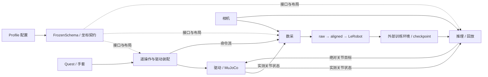

# MORLA 项目逻辑、数据结构与数据流导览

基于 2026-10-19 当前工作区源码梳理。本文区分当前实现、历史兼容路径和未来规划；没有启动硬件或 ROS 节点。

## 1. 项目的核心逻辑

MORLA 是 ROS 2 Humble 机器人工作空间。它把人类遥操作、机器人执行、演示数据集和模型推理接成闭环：



有两个贯穿全局的约束：

1. **数据契约**：每一个数值的单位、名字、索引、来源话题、动作含义均由 Profile/Schema 说明，采集、训练导出、推理和回放需要兼容。
2. **控制权契约**：遥操、策略和回放共享命令接口，因此需要租约、ACK、重锚及冻结流程来交接写入权。最终硬件动作由驱动执行。

## 2. 代码组织与职责

- `src/common/morla_core`：ROS 无关的 Profile 注册与校验、Schema、坐标变换、关节映射、所有权租约。
- `src/common/morla_bringup`：统一启动入口、机器人装配分派、控制协调器、手柄闸门、头部遥操、实测关节到 TF 的桥接。
- `src/common/morla_input`：Quest 网络接收、包时效/序列检查、轴约定转换、ROS 消息发布。
- `src/common/wuji_glove`：手套输入；手部输入进入各自重定向链。
- `src/common/quest3_video_streamer`：相机读取、供采集/推理使用的压缩图像话题、Quest WebRTC 视频。
- `src/common/morla_data_collect`：异步 raw 录制和离线处理。`pipeline/` 集中对齐、校验、清洗、导出、预览与检查。
- `src/common/morla_policy_inference`：观测装配、模型后端、动作块调度、安全执行、回放与 HITL。
- `src/common/morla_web_manager`：React/Vite 前端、FastAPI 后端、ROS 监控桥、子进程生命周期和离线任务。
- `src/robots/astral`、`nero`：机器人特定遥操、IK、驱动、仿真、Profile 包。
- `src/robots/wuji`、`xhand`：手部重定向、硬件控制/适配及仿真。Wuji 为 20 关节，XHand 为 12 关节。
- `src/robot_description`：URDF/MJCF、几何资产、关节约定与工具 frame；为 IK、仿真、TF 提供模型基础。
- `scripts/`：构建、验证、训练和运维入口。`third_party/` 是依赖；`tools/legacy/`、`docs/legacy/` 是历史资料，不能直接代表活动链路。

## 3. 启动与配置如何贯通

入口是 `morla_bringup/launch/robot.launch.py`：

```text
profile_id + mode(sim/real) + sdk_backend(fake/hardware)
  → ProfileRegistry.from_index()
  → robots.yaml 查 profile 包与 YAML 路径
  → validate_profile() 构造 RobotProfile / FrozenSchema / CoordinateContract
  → select_robot_stack()
  → 对应 Astral 或 Nero launch assembly
  → 输入、遥操、驱动/仿真、控制协调器等节点
```

`src/common/morla_bringup/config/robots.yaml` 当前登记 12 个 Profile。Profile YAML 位于 `src/robots/astral/morla_astral_robot/config/profiles/` 和 `src/robots/nero/morla_nero_robot/config/profiles/`。

Profile 声明 components、streams、state_blocks、action_blocks、cameras、writers、capabilities、backend_requirements、data、hardware、coordinate_contract。`write_resolved()` 可输出 `resolved_profile.json` 和 `frozen_schema.json`。

**当前装配仍有固定分支**：`select_robot_stack()` 只认识 Astral/Nero 和有限组件类型，选择现有 launch；它还不是任意组件自动生成启动图的系统。声明式自由组合属于 `docs/TODO.md` 的未来工作。Profile 校验也不验证 CAN/串口、相机在线、模型权重或硬件验收。

## 4. 核心数据结构

### RobotProfile 与 FrozenSchema

- `RobotProfile(values, frozen_schema)`：保存已校验的原始配置和公共 Schema。
- `StreamSpec`：`stream_key / topic / message_type / shape / dtype / unit / qos / timestamp_mode / required / source_kind / joint_names`。它说明一个 ROS 流的完整含义。
- `StateBlockSpec`：`block_id / stream_key / dim / feature_names / state_indices / stream_indices / physical_joint_names / limits`。先从流中按 `stream_indices` 取值，再填到状态向量的 `state_indices`。
- `ActionBlockSpec`：`block_id / dim / action_indices / semantics / writable / command_stream / writer_id / limits`。它说明动作向量某一段该交给哪个命令流和 writer。
- `FrozenSchema`：聚合上述结构、相机顺序、fps、action_source、hold_frames、max_gap_ms、sensor_specs 与 metadata；新录制以 schema_version=2 保存。

这些结构采用 frozen dataclass 表达冻结契约；其中字典内容并非递归不可变，业务上仍需遵守冻结后不改的约定。旧 `CollectSchema` 是 Astral 固定常量布局，仍用于旧数据和入口兼容；`FrozenPipelineSchema` 为既有离线代码提供块式访问视图。

### 三种 hash

- `layout_hash`：代码对 profile_id、robot_id、streams、state_blocks、action_blocks、cameras 的规范化 JSON 求 SHA-256。**不仅是向量维度的 hash**；话题等变化也影响它。
- `schema_hash`：完整序列化 Schema 去掉 metadata 后求 hash；若存在顶层 kinematics_hash，该值也进入此序列化结果。
- `kinematics_hash`：标识几何、关节约定、工具与坐标对齐身份，由坐标契约产生。

同为 8 维并不代表能互换数据集/模型；名称、排列、单位和运动学身份仍可能不同。

### 当前 Profile 的向量布局

以下 `state_dim = action_dim` 均来自直接调用当前 `validate_profile()` 的结果：

```text
astral_left_gripper          8 = left_arm(7) + left_ee(1)
astral_left_gripper_3cam     8 = left_arm(7) + left_ee(1)
astral_right_gripper         8 = right_arm(7) + right_ee(1)
astral_dual_gripper         16 = left_arm(7) + right_arm(7) + left_ee(1) + right_ee(1)
astral_dual_gripper_wuji    35 = left_arm(7) + right_arm(7) + left_ee(1) + right_ee(20)
astral_left_wuji            27 = left_arm(7) + left_ee(20)
astral_right_wuji           27 = right_arm(7) + right_ee(20)
astral_dual_wuji            54 = left_arm(7) + right_arm(7) + left_ee(20) + right_ee(20)
nero_left_xhand            19 = left_arm(7) + left_ee(12)
nero_right_xhand           19 = right_arm(7) + right_ee(12)
nero_dual_xhand            38 = left_arm(7) + right_arm(7) + left_ee(12) + right_ee(12)
nero_dual_arms             14 = left_arm(7) + right_arm(7)
```

双臂布局是先所有手臂，再所有末端。Nero 双 XHand 的动作维度 38 超过容量 32 的模型，需要合适的模型容量或显式缩减布局。

## 5. 遥操作数据流

```text
Quest 网络数据（腕、手柄、21×3 landmarks、头、身体）
  → PacketGuard：session / sequence / 单调时钟同步 / 去重 / 过期检查
  → morla_input：轴转换、frame 稳定闸门
  ├─ PoseStamped wrist → PoseProcessor → 增量目标 TCP → 工具链变换 → IK
  │                    → SafetyFilter → JointState 命令
  ├─ PoseArray landmarks → Wuji/XHand retarget → 手部关节命令
  ├─ pinch / trigger → 夹爪闭合比例 Float64
  └─ controller Joy → 头部目标 / 启动与回位 / 采集控制闸门
  → 驱动 SDK 或 MuJoCo
  → JointState 反馈 → 遥操种子/重锚、数采、推理、TF、Web
```

臂控制是相对运动：启动/重锚时记录 VR 原点与机器人实测初始位姿，再映射后续增量；不是把人手的世界坐标直接当机器人末端坐标。Astral 主循环位于 `astral_arm_teleop_node.py::_loop()`，依次检查控制权、回位状态、armed、标定和输入时效，再做位姿映射、工具变换、IK、安全过滤和发布。

默认 canonical 输入轴变换为 `(x,y,z)=(-x_unity,-z_unity,y_unity)`。IOBT 开启后 wrist/head 数据属于操作者 hips 参考系，**不是机器人 body frame**；Profile 再把输入朝向映射到机器人/求解器基座。输入端 sticky latch 和 hold gate 防止 world/body 在启动或丢包时切换造成跳变。

常见接口：`/left_arm/joint_commands` 与 `/left_arm/joint_states` 使用 `JointState`；手部命令/反馈也是命名关节数组。`/left_gripper/command` 是 0=开、1=合的闭合比例，`/left_gripper/joint_states` 是另一种弧度/回显语义，不能直接互换。各组合的准确路径以其 StreamSpec 为准。

## 6. 采集与文件数据流

`DataCollectNode` 根据 Schema 建订阅，状态包括 IDLE、RECORDING、PAUSED、SAVING。录制回调只将数据放入受锁保护的 deque，独立 writer 线程排空缓冲并写 HDF5，结束时先排空、裁剪数据集，再写 meta。缓冲丢弃计数进入元数据。

```text
session/
  episode000000/
    robot_data.h5
      /streams/<stream_key>/values       float32 [N_stream, D_stream]
      /streams/<stream_key>/timestamps   float64 [N_stream]
      /sensors/<sensor_key>/...          触觉/温度数组及有效位
    camera_data.h5
      /<camera_label>/images             [N_camera] 可变长 uint8 JPEG
      /<camera_label>/timestamps         float64 [N_camera]
      /<camera_label>/arrival_timestamps float64 [N_camera]
    meta.json
      task / session / episode_index / duration / schema / hashes
      runtime mode / stream counts / camera counts / dropped / events
    aligned_data.h5                      离线 align 后新建
```

writer 顶部旧注释写 `/cam_i/`，实际组名直接使用传入的语义相机 label，例如 `base`、`left_wrist`。

raw 中各流有独立长度和时间轴。关节 state 通常使用 ROS header 或到达时间；command 使用主机到达时间；相机保留源时间与主机到达时间。**不能按原始数组的同行号配对图像与关节。**

XHand 触觉是独立 sensor sidecar。典型 `force_raw` 为 `[N,5,120,3]`，`force_sum` 为 `[N,5,3]`，温度原始数组为 `[N,5,20]`，另有逐指 valid/temperature_valid。它不直接拼入现有模型 state/action，仿真与真机的来源和单位也分别记录。

## 7. raw 如何变成训练输入

统一入口：`scripts/data_pipeline.sh` → `morla_data_collect.pipeline.cli`。

```text
prepare 工作副本 → align → validate / 人工检查 → 可选 repair
  → 再 validate / verify-aligned / 人工检查
  → export-openpi（LeRobot v2.1）
  或 export-act（v3 + 自检）
  → 外部训练环境加载验证 / norm stats / 训练
```

`align_data.py::align_episode()` 按第一台配置相机的起止时间生成严格等间隔网格 `t0+i/fps`。关节 state 和相机通常选择最近源样本；夹爪比例和 command 动作使用不晚于目标时刻的最近命令。此处没有对 raw 关节做连续插值。相机/状态偏差超阈值写入 quality 位。

- `next_state`：`action[t]=state[t+1]`，原始末帧 action 保持末状态。
- `command`：从命令流按时间取值；旧 Schema 中无命令通道的块有兼容回退。
- 末尾可追加 `hold_frames`，并标记 synthetic hold。

aligned 包含 `/observation/state [T,D]`、`/action [T,D]`、timestamps、quality、每相机 JPEG 及 src_timestamps/src_offsets、来源帧信息、触觉和控制权标签。`raw_signature` 用于防止复用与 raw 不匹配的旧缓存。

`repair` 保守选择原始对齐帧的子集，图像、状态、传感器、标签随相同索引筛选；它与 raw→aligned 的采样过程是两个阶段。导出生成 Parquet 数值/标签、MP4 图像以及 meta 信息，`meta/morla_schema.json` 保留 MORLA 布局与运动学契约。

HITL 标签由 `/policy_inference/state` 的事件写入 meta，再按时间对齐：`intervention`、`intervention_valid`、`control_owner`。owner 编码为 0 unknown、1 policy、2 human、3 playback、4 pending、5 idle。没有事件的旧段不能推断成人工示范；合成 hold 帧也不会标成人工动作。

## 8. 策略推理与回放数据流

```text
机器人反馈 + 相机
  → ObsLayout.assemble_state() / 图像解码与 letterbox
  → ObsBatch(state[D], images{key: H×W×3 uint8}, prompt, metadata)
  → PolicyBackend：remote / inproc / stub
  → 绝对动作 chunk [K, action_dim]
  → ActionEngine：queue_sync / queue_async / rtc
  → 每控制 tick 取一行动作
  → ObsLayout.split_action() 按 action_indices 拆成 CmdTarget
  → SafeExecutor：有限值、限位、闭合比例、速度限制
  → ROS 命令流 → driver / sim → 新反馈
```

`backend_type` 表示传输/运行方式，`model` 才表示 ACT、pi05 等模型族。remote 通过 WebSocket 和 ndarray 序列化连接 `scripts/serve.py`，有模型布局/运动学握手及容量检查。模型侧可有 delta/归一化适配，但 MORLA 执行边界需要绝对目标；当前 `split_action()` 明确拒绝 delta 动作。

`queue_async` 的规划线程在锁外执行耗时推理，控制线程消费已缓存动作，结果返回再安装新 chunk；换块时有延迟补偿和按配置启用的时序融合/anchor 平滑。guided RTC 则把尚未执行的前缀给服务端作为约束。推理规划频率、数据集 fps、命令发送频率是不同概念。

回放读取 raw、aligned 或 LeRobot v2.1，映射后复用所有权仲裁和 SafeExecutor。raw 回放使用记录的状态轨迹，不要求先 align；也不播放历史相机画面。回放无需模型服务。

## 9. 控制权与 Web 控制流

策略纯状态机为 IDLE、POLICY、POLICY_PAUSED、PLAYBACK、PLAYBACK_PAUSED、HUMAN。实际交接由 `node.py` 处理 I/O：

```text
takeover
  → 暂停策略/回放输出，发布 pending 所有权
  → 各 writer 冻结并确认 transition_id
  → 臂节点 prepare_reanchor，基于新鲜反馈和 VR 建锚，返回 token
  → 全部满足后提交 HUMAN，匹配 token 的遥操才可输出
release
  → 冻结人工 writer、等待确认
  → 恢复被中断活动，按当前状态重新规划/重锚续播
```

`PolicyLease` 使用心跳、epoch、sequence、sent_at/租约有效期判断人工输出许可；已确认 IDLE 可释放控制权，活动租约过期则不能继续凭旧状态发命令。ACK 本身也不是动作完成证明。

Web 链路是 React → FastAPI `/api/v1/*` → MonitorNode → ROS topic/service。遥操、采集、推理有独立 launch 泳道；离线数据处理是独立任务。ROS 状态反向汇总为 UI snapshot，经 `/ws/telemetry` 返回前端。

机器人操作统一经过 `/morla/control/*` 协调器。`Trigger.success` 表示请求接纳；必须按 `/morla/control/state` 的 operation_id 跟踪 accepted/freezing/waiting_services/executing/completed/failed/cancelled。协调器负责能力检查、录制状态保护、冻结 writer、等待新鲜确认和调用实际服务。录制中阻止回位等动作，活动 writer/泳道也会阻止切换 Profile。

## 10. 本次核验与当前实现边界

完成了文档与关键源码交叉阅读，并用当前 `validate_profile()` 校验了 12 个 YAML 配置，全部通过；同时逐个构造 `ObsLayout` 检查推理观测接口。

**发现：5 个含夹爪的 Astral Profile 无法直接构造当前 ObsLayout。**

`astral_left_gripper`、`astral_left_gripper_3cam`、`astral_right_gripper`、`astral_dual_gripper`、`astral_dual_gripper_wuji` 的 state block 引用 `*_gripper_ratio`，而该流标为 `source_kind: command`；`robot_io.py:136` 只接受 state/command_echo，构造时抛出 `ValueError: state block ... uses non-state stream ...`。这是纯逻辑复现，不代表已运行 ROS 启动。旧 `CollectSchema` 升级路径有不同适配，不能用旧路径成功推断新 Profile 路径正常。本次未修复它。

系统 Python 和 bundled Python 均缺 PyYAML，直接 `validate-all` 命令未完成；上述校验通过系统 Ruby YAML 解析后转换 JSON，再调用真实 Python 校验函数。构造 ObsLayout 时仅为未使用的图像依赖 cv2 提供空占位模块，没有调用图像功能。未执行图像、ROS、MuJoCo、模型或硬件集成验证。

软件迁移文档将 P0–P10 标为完成，P11 真机与部署模型验收独立跟踪。活动工具仍保留 legacy solver tip；SDK 法兰、安装尺寸和任务 TCP 的物理核验未由本次分析证明。以 `docs/migration_progress.md` 和坐标专项计划的验收边界为准。

## 11. 推荐源码阅读路线

1. `src/common/morla_bringup/config/robots.yaml` 与一个具体 Profile：认识完整配置。
2. `src/common/morla_core/morla_core/profile.py:76`、`schema.py:259`：理解配置校验、流和向量块。
3. `src/common/morla_bringup/launch/robot.launch.py:18`、`robot_profile_launch.py:16`：理解实际装配分支。
4. `src/common/morla_input/morla_input/quest3_udp_mocap.py`、`packet_guard.py`：理解输入与时钟。
5. `src/robots/astral/astral_arm_teleop/astral_arm_teleop/astral_arm_teleop_node.py:1411`：沿一个 tick 看增量、工具变换、IK、安全输出。
6. `src/common/morla_data_collect/morla_data_collect/data_collect_node.py:702`、`data_writer.py:29`、`pipeline/align_data.py:99`：沿一个 episode 看落盘和监督信号生成。
7. `src/common/morla_policy_inference/morla_policy_inference/robot_io.py:119`、`backend.py:46`、`engine.py:102`、`node.py:1461`：沿一个 observation → chunk → command 闭环阅读。
8. `node.py:1254`、`src/common/morla_core/morla_core/ownership.py:16`、`src/common/morla_bringup/morla_bringup/control_coordinator_node.py`：理解交接权与动作完成状态。
9. `src/common/morla_web_manager/morla_web_manager/web_server.py` 与 `monitor_node.py`：理解 UI 到 ROS 的桥接，而后再看前端组件。
